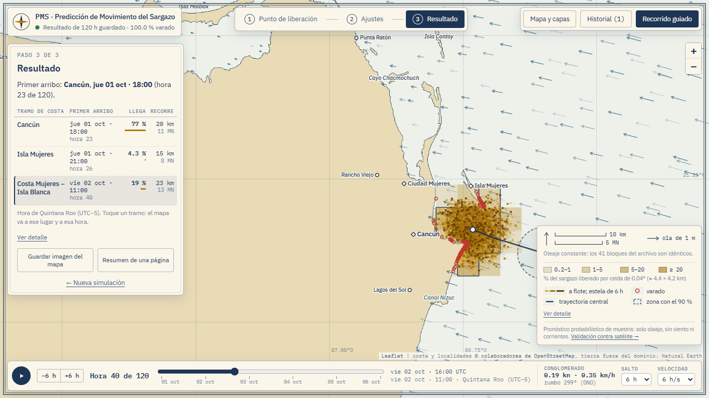
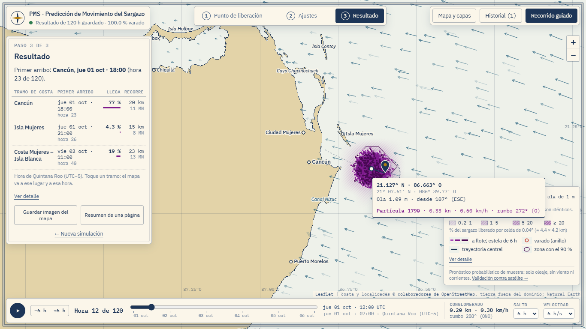
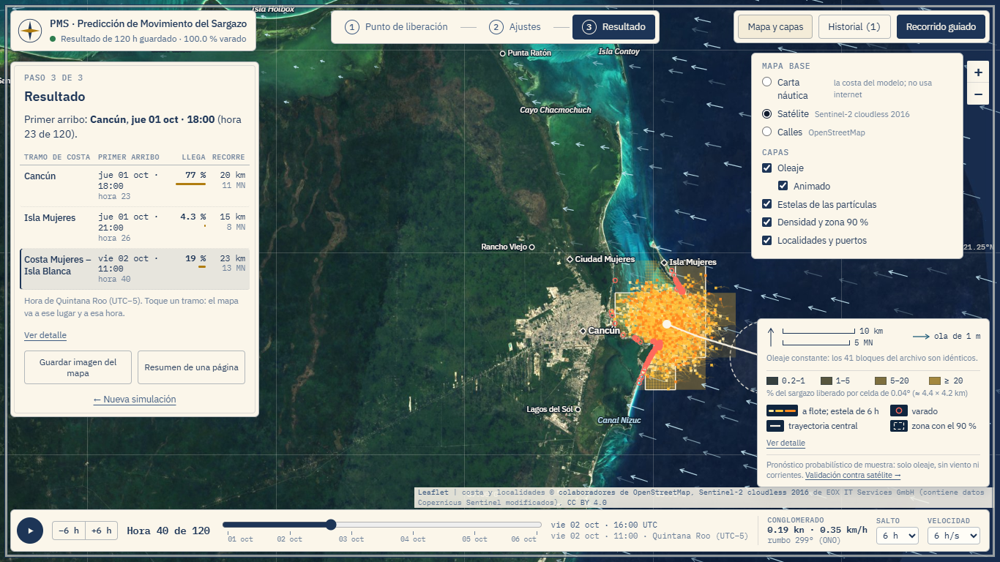
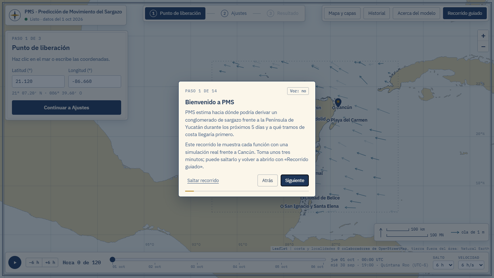
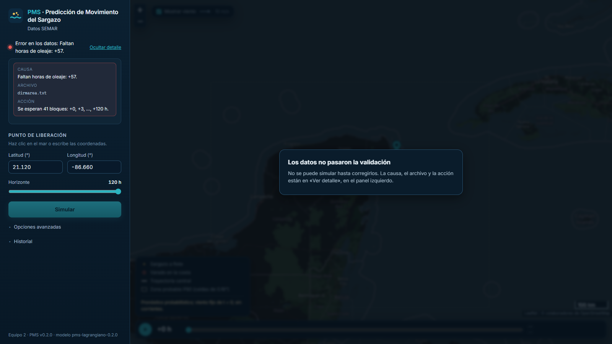

# PMS · Predicción de Movimiento del Sargazo

**v0.5.0 · demo: <https://pms-sargazo.vercel.app> · validación: <https://pms-sargazo.vercel.app/validacion>**

PMS estima hacia dónde podría derivar un conglomerado de sargazo frente a la Península de
Yucatán durante los próximos 5 días (120 h) y **a qué tramos de costa llegaría primero**. Lo
hace con un **modelo de partículas brownianas** que mueve cada partícula con la **deriva de
Stokes de la ola de viento** de SEMAR más un movimiento aleatorio. El resultado es una
**probabilidad**, no una certeza: el archivo de oleaje es de muestra y el modelo no incluye
viento ni corrientes. **La validación contra el sargazo visto por satélite muestra que todavía
no predice el movimiento mejor que suponer que el sargazo se queda quieto** (ver abajo).

La **v0.5.0 atiende las siete observaciones de SEMAR** a la v0.4.0: el falso contacto con
tierra, la interpolación, el oleaje en movimiento, el movimiento no uniforme, las escalas, la
información geográfica y la limpieza de la interfaz ([tabla](#qué-cambió-en-la-v050)).



*Interfaz «carta náutica» en 1366×768. A la izquierda, el paso 3 con la tabla de arribos por
tramo de costa; al tocar una fila el mapa va a ese tramo y a esa hora. En el mapa, la carta
propia con la costa del modelo, las partículas con estela, los anillos de las varadas sobre la
línea de costa, la densidad y el oleaje. Abajo a la derecha, las escalas (km, millas náuticas,
ola de 1 m y densidad); al pie, la línea de tiempo con fechas en UTC y en hora de Quintana Roo.*

---

## Contenido

1. [Qué cambió en la v0.5.0](#qué-cambió-en-la-v050)
2. [¿El modelo se mueve como el sargazo real?](#el-modelo-se-mueve-como-el-sargazo-real)
3. [El único archivo de entrada](#el-único-archivo-de-entrada)
4. [El modelo browniano](#el-modelo-browniano)
5. [La costa del modelo](#la-costa-del-modelo)
6. [Interpolación](#interpolación)
7. [La interfaz y el recorrido guiado](#la-interfaz-y-el-recorrido-guiado)
8. [Ejemplo: 120 h frente a Cancún](#ejemplo-120-h-frente-a-cancún)
9. [Cómo correrlo en local (Windows / PowerShell)](#cómo-correrlo-en-local-windows--powershell)
10. [Despliegue](#despliegue)
11. [API](#api)
12. [Mapa del repositorio](#mapa-del-repositorio)
13. [Pruebas y rendimiento](#pruebas-y-rendimiento)
14. [Límites honestos](#límites-honestos)
15. [Siguiente paso](#siguiente-paso)
16. [Preguntas para el profesor y SEMAR](#preguntas-para-el-profesor-y-semar)
17. [Créditos y atribuciones](#créditos-y-atribuciones)

---

## Qué cambió en la v0.5.0

SEMAR vio la v0.4.0 y dio siete observaciones. Lo que les gustó se conserva: el **recorrido
guiado** y la **hoja de la izquierda que guía paso a paso**, ahora actualizados con todo lo nuevo.

| Observación de SEMAR | Cómo quedó resuelta |
|---|---|
| 1. Marca contacto con tierra donde no la hay | La costa del modelo era un polígono dibujado a mano de 92 vértices. Ahora es una **máscara de ~105 m derivada de la línea de costa de OpenStreetMap**, la misma que dibuja la carta. «Varado» es tocar esa línea; ninguna partícula se dibuja sobre tierra. [Detalle](#la-costa-del-modelo) |
| 2. Interpolación | Auditadas y documentadas las tres (espacial, temporal y visual), con pruebas contra casos analíticos. Se corrigieron dos fallas: mar sin ola junto a la costa y direcciones que se cancelan. [Detalle](#interpolación) |
| 3. Oleaje en movimiento | Trazos que fluyen hacia donde viaja la ola; largo y rapidez proporcionales a la altura, sincronizados con la hora. Interruptor para dejarlos fijos u ocultarlos; se apagan solos con `prefers-reduced-motion`. La interfaz dice si los bloques del archivo son idénticos |
| 4. Que se note que el movimiento no es uniforme | Estela de 6 h detrás de cada partícula, más larga y más oscura cuanto más rápida; rapidez del conglomerado en nudos y km/h que cambia con la hora; en pausa, el cursor sobre una partícula da su rapidez y su rumbo |
| 5. Escalas | Barra doble en km y millas náuticas que sigue al zoom; flecha de ola de «1 m» a escala fija en cualquier zoom; densidad con unidades y rangos; línea de tiempo con fechas en UTC y en hora de Quintana Roo, marcas por día, «hora N de 120», saltos de 3/6/12 h y velocidad; km, MN y nudos en los resultados; coordenadas también en grados y minutos; radio inicial a escala del mapa |
| 6. Información geográfica | Localidades, islas, cabos, bahías y puertos de OpenStreetMap, con rótulos que no se enciman y aparecen según el zoom. Tres mapas base: carta propia (no usa internet), satélite (Sentinel-2 cloudless 2016, CC BY 4.0) y calles |
| 7. Mucha información | Por defecto solo el mapa, el paso actual, la línea de tiempo y un resultado principal. Lo demás, bajo «Ver detalle». [Qué se quitó](#qué-se-quitó-o-se-escondió) |

Además:

- **Tabla de arribos por tramo de costa** como resultado principal: primer arribo (fecha y
  hora), porcentaje que llega y distancia recorrida. Al tocar una fila, el mapa va a ese tramo
  y a esa hora.
- **Exportar**: imagen del mapa (PNG) y resumen de una página para imprimir o guardar como PDF,
  con fecha, parámetros, tabla de arribos, escalas y límites del modelo.
- El modelo pasa a **`pms-browniano-0.4.0`** porque la costa y la interpolación cambian los
  resultados ([cuánto](#cuánto-cambian-los-resultados)).

> **Pendiente:** la validación contra satélite de abajo se calculó con la v0.4.0 (modelo 0.3.0
> y la costa anterior). Hay que repetirla con el modelo 0.4.0; la corrida completa se detuvo
> por falta de memoria en el equipo y no se ha relanzado.

## ¿El modelo se mueve como el sargazo real?

El profesor preguntó cómo sabemos que el comportamiento del modelo es real. La v0.4.0 lo midió:
toma días de 2022–2026 con sargazo visto por satélite (AFAI de USF en NOAA AOML), siembra
partículas donde estaba, las mueve con el modelo usando el oleaje real de esas fechas
(MFWAM de Copernicus Marine, escrito como `dirmarea.txt` en el formato de SEMAR) y compara
contra lo que el satélite vio 3, 5 y 7 días después. La referencia mínima es suponer que el sargazo **no se
mueve** (persistencia, E0).

<!-- validacion:inicio (generado por scripts/validar.py; no editar a mano) -->
**Con datos satelitales 2022–2026, el modelo v0.3 (solo oleaje) no se distingue de suponer que el sargazo no se mueve; ni agregando corrientes (E4 Corriente SMOC total + browniano) se supera a la persistencia.**

FSS a 25 km (1 = perfecto) en 11 casos de evaluación 2025–2026 (γ y K_h de E3 calibrados con 14 casos anteriores), media e IC 95 %:

| Experimento | +3 d | +5 d | +7 d |
|---|---|---|---|
| E0 Persistencia | 0.375 [0.291–0.452] | 0.354 [0.272–0.424] | 0.364 [0.308–0.411] |
| E1 Solo browniano | 0.379 [0.294–0.455]<br>Δ vs E0 +0.004 [-0.001, +0.010] | 0.357 [0.275–0.429]<br>Δ vs E0 +0.003 [-0.004, +0.012] | 0.371 [0.313–0.420]<br>Δ vs E0 +0.007 [+0.001, +0.014] |
| E2 PMS v0.3 | 0.377 [0.296–0.449]<br>Δ vs E0 +0.002 [-0.017, +0.024] | 0.332 [0.254–0.404]<br>Δ vs E0 -0.022 [-0.045, +0.001] | 0.345 [0.280–0.410]<br>Δ vs E0 -0.019 [-0.055, +0.018] |
| E3 PMS calibrado | 0.378 [0.293–0.454]<br>Δ vs E0 +0.003 [-0.004, +0.009] | 0.352 [0.270–0.423]<br>Δ vs E0 -0.002 [-0.009, +0.006] | 0.363 [0.307–0.409]<br>Δ vs E0 -0.001 [-0.006, +0.005] |
| E4 Corriente SMOC total + browniano | 0.359 [0.270–0.437]<br>Δ vs E0 -0.016 [-0.077, +0.049] | 0.283 [0.215–0.346]<br>Δ vs E0 -0.071 [-0.134, -0.006] | 0.254 [0.190–0.315]<br>Δ vs E0 -0.110 [-0.165, -0.049] |
| E5 Corriente sin Stokes + viento 1 % + ola | 0.342 [0.261–0.416]<br>Δ vs E0 -0.033 [-0.091, +0.025] | 0.269 [0.200–0.333]<br>Δ vs E0 -0.085 [-0.144, -0.020] | 0.226 [0.162–0.289]<br>Δ vs E0 -0.138 [-0.187, -0.084] |
| E5 Corriente sin Stokes + viento 2 % + ola | 0.297 [0.227–0.366]<br>Δ vs E0 -0.078 [-0.125, -0.034] | 0.255 [0.186–0.317]<br>Δ vs E0 -0.099 [-0.152, -0.041] | 0.199 [0.137–0.259]<br>Δ vs E0 -0.165 [-0.209, -0.122] |
| E5 Corriente sin Stokes + viento 3 % + ola | 0.282 [0.213–0.351]<br>Δ vs E0 -0.093 [-0.145, -0.045] | 0.227 [0.169–0.280]<br>Δ vs E0 -0.126 [-0.173, -0.077] | 0.182 [0.122–0.244]<br>Δ vs E0 -0.182 [-0.228, -0.136] |

Reporte completo con método, casos y limitaciones: [docs/validacion.md](docs/validacion.md) · página en la app: `/validacion`.
<!-- validacion:fin -->

### Qué cambió en la v0.4.0

- **Validación** contra el sargazo observado por satélite: paquete `validacion/`,
  `python scripts/validar.py` (todo desde cero con un comando), resultados en
  [`docs/validacion/`](docs/validacion/), reporte en [`docs/validacion.md`](docs/validacion.md)
  (lo genera el script; verifica sus propios conteos),
  fuentes en [`docs/fuentes_validacion.md`](docs/fuentes_validacion.md) y página `/validacion`
  enlazada desde la leyenda.
- **Forzamientos de Copernicus Marine** (toolbox `copernicusmarine`, cuenta gratuita con
  `copernicusmarine login`; las credenciales no entran al repositorio): ola de viento MFWAM a
  0.083° (reanálisis de 0.2° antes de nov 2022) y corriente SMOC a 0.083°. El viento de E5 viene
  de ERA5 vía Open-Meteo. Una primera corrida con oleaje y corriente de Open-Meteo quedó bloqueada
  por su cuota diaria y se rehizo completa con Copernicus.
- **`scripts/generar_dirmarea.py`**: escribe un `dirmarea.txt` con la ola de viento real de una
  fecha, en el mismo formato que el de SEMAR (`python main.py --datos <carpeta>` lo usa).
- **El producto no cambió en esa versión**: siguió usando solo `dirmarea.txt` y el modelo
  `pms-browniano-0.3.0`. `simular()` delega en `integrar()` (posiciones iniciales y hora de inicio libres) con
  resultados idénticos byte a byte.
- **CI en verde** de nuevo ahora que el repositorio es público.

### Qué cambió en la v0.3.0

| | v0.2.0 | v0.3.0 |
|---|---|---|
| Entrada | `salidadatos.txt` (viento) + `dirmarea.txt` (oleaje) | **Solo `dirmarea.txt`**; el viento se eliminó del repositorio y del código |
| Modelo | `pms-lagrangiano-0.2.0`: arrastre del viento α·u_w + difusión | **`pms-browniano-0.3.0`**: deriva de Stokes de la ola + movimiento browniano |
| Parámetros | α (arrastre del viento), K_h | **γ** (factor de la deriva por oleaje), **K_h** |
| Malla | La del viento; el oleaje se interpolaba (estaba desplazado 0.08°) | La **nativa** de `dirmarea.txt`, sin interpolar mallas |
| Interfaz | Panel oscuro a la izquierda y mapa | **«Carta náutica»**: tema claro, mapa a pantalla completa, **tres pasos** y **recorrido guiado** |

## El único archivo de entrada

`data/semar/dirmarea.txt`: oleaje de viento entregado por SEMAR como muestra. El repositorio
es **público**, así que el archivo también lo es; está **pendiente confirmar la autorización de
SEMAR** para difundirlo (ver
[`data/semar/README.md`](data/semar/README.md)).

| Elemento | Formato |
|---|---|
| Separador | `;` |
| Encabezado | `LON;LAT;dirolavto;alturaolavto` |
| Bloques | 41, cada uno empieza con `01OCT2026 00 h` (fecha base, hora base, hora de pronóstico h = 0, 3, …, 120) |
| Filas por bloque | 4 794: malla 94 × 51 de 0.16°, lon −98.00 … −83.12, lat 23 … 15 (de norte a sur, de oeste a este) |
| `dirolavto` | Dirección **desde** la que viene la ola de viento (grados, 0 = norte) |
| `alturaolavto` | Altura de la ola de viento (m) |
| Relleno | `-9.99e+08` = sin dato (tierra) → NaN |

**Dominio del modelo**: el recuadro de Yucatán alineado a esa malla, lon −92.08 … −84.08 y
lat 16.92 … 23.00: 51 × 39 = 1 989 nodos, de los cuales 1 295 tienen ola.

**Hallazgos del archivo de muestra** (verificados por el validador y por
`tests/test_validador.py::test_datos_reales_de_semar`):

- Los **41 bloques son idénticos** byte por byte: el oleaje no cambia en el tiempo. El validador
  lo reporta como advertencia y el modelo igual interpola entre bloques cada 3 h, así que
  funcionará sin cambios cuando lleguen datos que sí varíen.
- La fecha (1 oct 2026 00 UTC) es de muestra.
- En el dominio, la altura va de 0.11 a 1.82 m (media 1.02 m). Frente a Cancún la ola viene
  del ESE (~107°) con ~1.1 m.
- La máscara de mar del archivo y la costa del modelo difieren en 64 nodos de 1 989
  (9 con ola sobre «tierra» del modelo, 55 sin ola sobre «mar» del modelo). Es esperable: la
  malla de oleaje es de ~17 km y la costa, de ~100 m.

**El validador** (`src/ingestion/validador.py`) no se detiene en el primer error y reporta
cada hallazgo con la causa, el archivo y la acción. Revisa:

- encabezado y columnas, filas defectuosas y fecha legible (mapa propio de meses en inglés);
- horas +0 a +120 cada 3 h, sin huecos ni desorden;
- malla regular de 0.16°, rectangular, igual en todos los bloques, y cobertura del dominio;
- relleno → NaN, con dirección y altura faltando juntas;
- rangos: altura de 0 a 20 m y dirección de 0 a 360°;
- advertencia por bloques idénticos;
- comparación de la máscara de mar con la costa del modelo.

## El modelo browniano

`pms-browniano-0.4.0`. Para cada partícula y cada paso Δt = 1 h:

```
X(t+Δt) = X(t) + u_ola(X,t)·Δt + √(2·K_h·Δt)·ξ ,     ξ ~ N(0, 1) en cada eje

|u_ola| = γ · 2π³·H² / (g·T³)     hacia donde viaja la ola (dirolavto + 180°)
T = 4.0·√H                        período SUPUESTO (el archivo no trae período)
```

Es la **deriva de Stokes** superficial de una ola en aguas profundas. Con el período
supuesto se simplifica a |u_ola| ≈ γ · 0.0988·√H: con H = 1.25 m, T ≈ 4.5 s y
|u_ola| ≈ **0.11 m/s** (unos 9.5 km por día).

| Parámetro | Qué hace | Valor por defecto | Rango | Estado |
|---|---|---|---|---|
| **γ** | Escala la deriva de Stokes: 0 la apaga, 1 es la estimación base, 3 la triplica | 1 | 0–3 | Preliminar, sin calibrar |
| **K_h** | Intensidad del movimiento browniano: cuánto se dispersan las partículas al azar | 10 m²/s | 0–100 | Preliminar, sin calibrar |
| Radio inicial | Tamaño del conglomerado al soltarlo | 5 km | 0.5–50 | — |
| Partículas | Cuántas partículas representan al conglomerado | 2 000 | 100–5 000 | — |
| Horizonte | Horas simuladas | 120 h | 24–120 | — |
| Semilla | Misma semilla y mismos ajustes dan el mismo resultado | 2026 | — | — |

**El supuesto del período.** `dirmarea.txt` trae altura y dirección, pero no período. La
deriva de Stokes depende fuertemente del período (∝ 1/T³). T = 4.0·√H es una relación
empírica aproximada para mar de viento en desarrollo, documentada en `src/config.py`, en este
README y en la interfaz (paso 2, «Avanzado», y recorrido guiado). Si SEMAR entrega el
período, basta con usarlo en `src/model/campos.py`.

**Implementación** (`src/model/`):

- la altura y la dirección se interpolan en el espacio y en el tiempo como se explica en
  [Interpolación](#interpolación);
- el término determinista se integra por punto medio (RK2);
- el paso de metros a grados corrige la longitud por cos(lat);
- el segmento que recorre cada partícula en un paso se revisa contra la costa **cada media
  celda de la máscara (~50 m)**; si la toca, la partícula queda **varada** en el último punto
  en el mar (bisección) y ya no se mueve. Queda **fuera del dominio** si sale del recuadro;
- la semilla hace reproducibles las corridas.

**Salidas**:

- **tabla de arribos** por tramo de costa: hora del primer arribo y del arribo mediano,
  fracción de partículas (Alta ≥ 30 %, Media ≥ 10 %, Baja ≥ 2 %, Muy baja), distancia recorrida
  en línea recta (mediana, en km y millas náuticas) y recuadro del tramo;
- centroide de las partículas a flote, con su rapidez y su rumbo hora por hora;
- radio P90 a su alrededor;
- registro JSON con la huella SHA-256 de `dirmarea.txt` y una bitácora.

La interfaz deriva de las posiciones la **densidad** (porcentaje del sargazo liberado por
celda de 0.04°, ~4.4 × 4.2 km) y la **zona del 90 %** (el menor conjunto de esas celdas con el
90 % de las partículas).

## La costa del modelo

**La causa del falso contacto con tierra.** La costa de la v0.4.0 era una simplificación
manual: 92 vértices para la península, Cozumel, Isla Mujeres (4 vértices) y el occidente de
Cuba. No salía de los nodos de relleno de la malla, como se sospechaba, y la interfaz nunca la
dibujaba: el anillo de «varado» aparecía sobre el mar del mapa base. Medido contra la línea de
costa de OpenStreetMap, ese polígono se separaba 1.5 km de mediana, 8.7 km en el percentil 90
y hasta 17.6 km, y marcaba como tierra 4 076 km² de mar en Quintana Roo (Bahía de la Ascensión,
Bahía de Chetumal, laguna de Yalahau).

Caso que lo reproduce (el punto por defecto de la interfaz: 21.12° N, 86.66° O, 2 000
partículas, 120 h, v0.4.0): el **41.5 % de las partículas «varadas» quedaba a más de 1 km de
tierra real y el 17.8 % a más de 3 km**. Una de ellas «varaba» a la hora 36 en 21.188° N,
86.768° O, en medio de la Bahía de Mujeres, a 3.8 km de la tierra más cercana. Frente a Tulum
el error era al revés: el 42 % de las varadas quedaba dibujado tierra adentro.

**La corrección.**

- `scripts/construir_costa.py` descarga la línea de costa de **OpenStreetMap** (vías
  `natural=coastline`, 4 009 vías y 347 412 vértices, datos al 16/09/2026), la rasteriza a
  **0.001° (~105 m)** e inunda el mar desde mar abierto: lo que el mar no alcanza es tierra.
  El resultado es `src/model/datos/costa.npz` (1 bit por celda, 86 KB). Se eligió OSM porque
  es la costa que se ve en el mapa: Natural Earth 10 m se separa de ella 0.8 km de mediana (y
  marca tierra a 2 km de San Miguel de Cozumel) y GSHHG, 0.2 km de mediana y hasta 3.6 km.
- Comprobación independiente: la máscara da 188 815 km² de tierra en el dominio; GSHHG en
  resolución completa, 189 183 km² (0.2 % de diferencia).
- **La interfaz descarga esa misma máscara** (`/api/costa/tierra.bin`, 63 KB con gzip) y con
  ella pinta la carta, valida el punto de liberación y anima. Las pruebas comprueban que el
  navegador y el modelo dan el mismo «tierra o mar» y que ninguna partícula se dibuja sobre
  tierra, tampoco entre dos horas guardadas.
- El criterio de varado revisaba 4 puntos por paso (cada ~375 m con pasos grandes) contra una
  máscara de 440 m: una partícula podía saltarse la zona hotelera de Cancún o Isla Mujeres.
  Ahora revisa cada ~50 m.
- Los **tramos de costa** pasan de 15 a 20: Isla Mujeres, Isla Contoy, Banco Chinchorro, los
  arrecifes del Banco de Campeche y la Bahía de Chetumal tienen el suyo. Sus límites son una
  convención de PMS (latitudes y longitudes fijas, listadas en `src/model/costa.py` y en el
  detalle del resultado), no una división oficial.
- Las posiciones se guardan redondeadas a 0.0002° (~22 m). El registro y el navegador cuidan
  que ese redondeo no meta a tierra una partícula que estaba en el mar.

**Límites de la costa.** No resuelve canales ni bocas de menos de ~200 m: las lagunas que
solo comunican por ahí (Nichupté, por ejemplo) cuentan como tierra. No distingue playa,
manglar, arrecife ni muelle. Depende de cómo esté trazada la costa en OpenStreetMap.

### Cuánto cambian los resultados

Mismos parámetros (2 000 partículas, 120 h, γ = 1, K_h = 10 m²/s, semilla 2026), antes y
después de la corrección de la costa y de la interpolación:

| Punto de liberación | Varado en 120 h, v0.4.0 | Varado en 120 h, v0.5.0 | Arribo principal, v0.5.0 |
|---|---|---|---|
| Cancún (punto por defecto) | 100 % | 100 % | Cancún, 91.7 % |
| Frente a Cancún, a 30 km | 93.8 % | 77.0 % | Isla Mujeres, 33.6 % |
| Mar abierto (21.00° N, 86.30° O) | 18.9 % | 13.4 % | Cancún, 13.2 % |
| Canal de Cozumel | 18.4 % | 99.5 % | Playa del Carmen, 54.7 % |
| Frente a Tulum, a 20 km | 100 % | 100 % | Tulum, 98.2 % |
| Frente a Sian Ka'an | 58.9 % | 99.7 % | Sian Ka'an, 99.7 % |
| Frente a Mahahual, a 15 km | 100 % | 100 % | Mahahual, 100 % |
| Este de Cozumel | 100 % | 100 % | Cozumel, 100 % |

Los dos cambios grandes (canal de Cozumel y Sian Ka'an) vienen de la interpolación: en la
v0.4.0 las partículas se quedaban sin deriva en la franja de mar sin ola junto a la costa.
Frente a Cancún baja porque la costa ya no está 3 km mar adentro.

## Interpolación

Hay tres. Las reglas de las dos primeras están en `src/model/campos.py`; la interfaz usa las
mismas (`src/view/js/datos.js`) y una prueba compara ambas.

**a) Espacial: del nodo de la malla a la posición de la partícula.**

- Cada valor del archivo se toma **en su nodo** (LON, LAT). Los nodos caen en −92.08, −91.92…
  porque la malla de SEMAR empieza en −98°: ese residuo de 0.08° no es un desfase del modelo.
  Comparado con la costa real, el relleno del archivo coincide al 96.8 % sin desplazar la
  malla y entre 95.8 y 97.4 % desplazándola ±0.08°: no hay evidencia de que los valores estén
  en esquinas de celda, pero la diferencia (unos 8 nodos de 1 989) no permite descartarlo.
  Es una [pregunta para SEMAR](#preguntas-para-el-profesor-y-semar).
- Entre nodos, **bilineal**: la altura directamente y la dirección por sus componentes seno y
  coseno (350° y 10° dan 0°, no 180°). Los nodos sin dato no entran en el promedio y los pesos
  se renormalizan. Fuera de la malla se usa el nodo del borde.
- **Falla corregida 1.** La malla de 0.16° dejaba sin ola celdas enteras de mar: 5 288 km² del
  dominio (1.4 % del mar), entre ellos la franja frente a Playa del Carmen, Akumal y Sian
  Ka'an. Una partícula que entraba ahí se quedaba sin deriva. Ahora cada nodo sin dato vecino
  de nodos con dato toma su promedio, hasta 2 nodos hacia la costa. Quedan sin ola 279 km², al
  fondo de la Bahía de Chetumal. El hover avisa cuando la ola es «extendida a la costa».
- **Falla corregida 2.** Si las direcciones que se promedian se cancelan (90° y 270° a partes
  iguales), salía «del norte» con la rapidez completa. Ahora no hay dirección y la deriva es
  cero. En el archivo de muestra no ocurre: la resultante mínima entre nodos vecinos es 0.82.

**b) Temporal: entre bloques de 3 h.** Lineal en altura, seno y coseno. Antes del primer
bloque y después del último se usa el más cercano; los bloques pueden tener cualquier
espaciado. El integrador (punto medio) evalúa la ola a media hora del paso. Con el archivo de
muestra los 41 bloques son idénticos y no tiene efecto; con bloques distintos, las pruebas
comprueban que el navegador y el modelo dan la misma ola en horas intermedias.

**c) Visual: entre horas guardadas.** La simulación guarda una posición por hora. La interfaz
dibuja cada partícula en la **línea recta entre las dos horas que la rodean**, así que la
animación es continua a cualquier velocidad. Esa recta es el mismo segmento que el modelo
revisó contra la costa. Como las posiciones se guardan redondeadas a ~22 m, unas pocas
posiciones intermedias rozan una celda de tierra (6 de 213 042 en el caso de Cancún); en ese
caso la partícula se dibuja en el último punto de la recta que sigue en el mar.

**Pruebas** (`tests/test_interpolacion.py`): campo lineal reproducido con error < 10⁻¹²; valor
exacto en los nodos y promedio a media celda; continuidad entre celdas; borde de la malla;
seno y coseno; direcciones opuestas; nodos sin dato y franja costera; rampa temporal exacta,
bloques irregulares y extremos; y el integrador contra dos soluciones exactas (velocidad
lineal en el tiempo y cizalla).

## La interfaz y el recorrido guiado

Diseño propio de **carta náutica**: papel crema, tinta azul marino, IBM Plex Sans para el
texto y IBM Plex Mono para los datos. El mapa ocupa toda la pantalla y los controles flotan
sobre él.

**A la vista por defecto**: el mapa, la hoja del paso actual, la línea de tiempo y una
leyenda mínima con las escalas. Los **tres pasos**, uno a la vez:

1. **Punto de liberación**: clic en el mar o lat/lon (se muestran también en grados y
   minutos); el círculo punteado es el radio inicial, a escala del mapa.
2. **Ajustes**: horizonte y, plegado en «Avanzado», radio, partículas, γ, K_h y semilla.
3. **Resultado**: la **tabla de arribos** por tramo de costa (primer arribo en hora de
   Quintana Roo, porcentaje que llega y distancia en km y MN). Tocar una fila lleva el mapa a
   ese tramo y a esa hora. «Ver detalle» tiene el porcentaje varado, el radio P90, la rapidez
   media, las horas en UTC, los parámetros, la huella del archivo y las advertencias. Dos
   botones exportan la imagen del mapa y el resumen de una página.

**El mapa.**

- **Mapa base** («Mapa y capas»): la **carta propia**, pintada con la máscara de costa del
  modelo y sin internet; **satélite** (Sentinel-2 cloudless 2016 de EOX); y **calles**
  (OpenStreetMap). Sobre el satélite las capas cambian a trazo claro.
- **Localidades y puertos** de OpenStreetMap: aparecen según el zoom y su tamaño, sin
  encimarse. El rombo marca los poblados con puerto o terminal marítima. Las bahías, canales,
  islas y arrecifes van en cursiva.
- **Oleaje**: trazos que fluyen hacia donde viaja la ola. Su largo es la altura a 22 px por
  metro en cualquier zoom, y su rapidez también es proporcional a la altura. Se puede dejar
  fijo (una flecha por nodo con dato) u ocultar.
- **Partículas**: posición interpolada entre horas, con estela de 6 h en tres tonos según la
  rapidez (menos de 0.2 kn, de 0.2 a 0.4 kn, más de 0.4 kn). Anillo rojo para las varadas.
- **Densidad** en cuatro clases (0.2–1, 1–5, 5–20 y ≥ 20 % del sargazo liberado por celda de
  0.04°) y contorno punteado de la zona con el 90 %. No se pinta sobre tierra.
- **Hover**: coordenadas en decimales y en grados y minutos, y la ola interpolada como en el
  modelo. En pausa, sobre una partícula: su rapidez (kn y km/h) y su rumbo.

**Escalas y leyenda** (abajo a la derecha): barra doble en km y millas náuticas que sigue al
zoom, norte, flecha de ola de 1 m, clases de densidad con su unidad y símbolos. «Ver detalle»
explica cada uno y lista las fuentes. Al pie, discretos, el aviso de límites y el enlace a la
validación.

**Línea de tiempo**: reproducir o pausar, «Hora N de 120», deslizador con una marca por día,
fecha en UTC y en hora de Quintana Roo (UTC−5), rapidez y rumbo del conglomerado, saltos de 3,
6 o 12 h y velocidad de 3 a 24 h/s. Teclas: espacio; ← y → una hora; con Mayús, un salto.

**Estado** en una sola línea (validando / listo / calculando / error), con el detalle al hacer
clic. Si el archivo no es válido, un velo muestra la causa, el archivo y la acción.
**Historial** plegado: fecha, arribo principal y % varado; clic para reabrir.

### Paleta del sargazo y contraste

En la primera v0.5.0 el sargazo iba en dorado y sobre la carta se confundía con la tierra, que
es de color ante: la partícula lenta daba 1.6:1 contra la tierra y la densidad parecían islas.
Ahora va en **púrpura** sobre la carta y las calles y en **rosa claro** sobre el satélite, un
tono que no tienen la tierra ni el mar de ningún mapa base, y no depende solo del tono:

- **a flote**: cuadro relleno con borde del color contrario al mapa;
- **varado**: anillo hueco rojo con halo;
- **densidad**: mancha de bordes suaves con trama de líneas diagonales, recortada a la costa;
- **zona con el 90 %**: una línea fina, sin esquinas rectas.

<!-- contraste:inicio (generado por scripts/medir_contraste.py; no editar a mano) -->
Razón de contraste WCAG (1 = igual, 21 = negro sobre blanco) contra la **mediana** de la tierra y del mar de cada mapa base; en negritas, lo que llega a 3:1, el mínimo de WCAG para objetos gráficos. Lo genera `python scripts/medir_contraste.py`; detalle y extremos claro y oscuro en [`docs/contraste.md`](docs/contraste.md).

| Elemento | Forma | Carta: tierra · mar | Satélite: tierra · mar | Calles: tierra · mar |
|---|---|---|---|---|
| Partícula a flote, lenta | cuadro relleno con borde | **3.3** · **4.3** | **5.5** · **7.2** | **3.9** · **3.5** |
| Partícula a flote, media | cuadro relleno con borde | **5.9** · **7.7** | **7.3** · **9.6** | **6.8** · **6.2** |
| Partícula a flote, rápida | cuadro relleno con borde | **9.9** · **12.9** | **10.1** · **13.3** | **11.5** · **10.4** |
| Densidad 0.2–1 % (línea de la trama) | trama diagonal | 1.0 · 1.3 | 1.1 · 1.4 | 1.4 · 1.3 |
| Densidad 1–5 % (línea de la trama) | trama diagonal | 1.3 · 1.7 | 1.5 · 1.9 | 1.9 · 1.7 |
| Densidad 5–20 % (línea de la trama) | trama diagonal | 1.8 · 2.4 | 2.2 · 2.9 | 2.5 · 2.3 |
| Densidad ≥ 20 % (línea de la trama) | trama diagonal | 2.6 · **3.4** | **3.1** · **4.1** | **3.4** · **3.1** |
| Zona con el 90 % (línea) | línea fina | **6.0** · **7.8** | **6.8** · **8.9** | **7.5** · **6.7** |
| Varado | anillo hueco con halo | **3.7** · **4.8** | **3.9** · **5.2** | **4.2** · **3.8** |

Fondos medidos: carta propia: tierra `#e3d3a8` y mar `#eef1ea`; calles: tierra `#e6e5c9` y mar `#cedcd6`; satélite: tierra `#223a35` y mar `#10223a`.

Diferencia de color ΔE (CIE76; más de ~10 ya se distingue a simple vista) entre la partícula a flote media y lo que la rodea, con visión normal y con daltonismo simulado:

| Mapa base | Visión | vs tierra | vs mar | vs varado |
|---|---|---|---|---|
| Carta propia | visión normal | 100 | 96 | 81 |
| Carta propia | protanopía | 90 | 83 | 77 |
| Carta propia | deuteranopía | 80 | 73 | 83 |
| Carta propia | tritanopía | 59 | 72 | 52 |
| Calles | visión normal | 100 | 92 | 81 |
| Calles | protanopía | 87 | 76 | 77 |
| Calles | deuteranopía | 77 | 65 | 83 |
| Calles | tritanopía | 67 | 69 | 52 |
| Satélite | visión normal | 81 | 78 | 82 |
| Satélite | protanopía | 63 | 65 | 76 |
| Satélite | deuteranopía | 64 | 70 | 80 |
| Satélite | tritanopía | 72 | 80 | 61 |
<!-- contraste:fin -->

Lo que no llega a 3:1: las clases bajas de densidad, que son tenues a propósito (poca opacidad
es poco sargazo), y las partículas sobre lo más claro del satélite (playas y zonas urbanas),
donde las separa su borde oscuro.

### Qué se quitó o se escondió

| Elemento de la v0.4.0 | En la v0.5.0 |
|---|---|
| Rosa de los vientos decorativa | Se quitó; queda una flecha de norte junto a la escala |
| Interruptor «Mostrar oleaje» en la cabecera | Pasó al panel «Mapa y capas», cerrado por defecto |
| Leyenda con 4 símbolos siempre visibles | Antes de simular solo muestra las escalas; los símbolos aparecen con el resultado |
| «% varado» y «Radio P90» como cifras grandes del paso 3 | Bajo «Ver detalle»; el resultado principal es la tabla de arribos |
| Etiquetas Alta/Media/Baja en la lista de arribos | Bajo «Ver detalle»; en la tabla, el porcentaje con una barra |
| Texto de ayuda bajo el horizonte y guía larga del paso 1 | Una línea; la explicación está en el recorrido guiado |
| Mapa de calles (carreteras y rótulos de OSM) como fondo | Carta propia más limpia por defecto; calles y satélite, a elección |
| Zona P90 en cuadros de 0.16° (17 km) que invadían tierra | Celdas de 0.04° recortadas con la costa |
| Control de escala de Leaflet (solo km) | Barra doble km y MN dentro de la leyenda |

**Recorrido guiado.** Se abre solo la primera vez (se recuerda en `localStorage`) y siempre
está disponible con el botón «Recorrido guiado». Oscurece la pantalla, ilumina el elemento
del que habla y muestra una tarjeta con «Paso k de N» y los botones «Siguiente», «Atrás» y
«Saltar». Teclas: Esc salta; → y Enter avanzan.

Sus 14 pasos:

1. bienvenida;
2. los datos y el oleaje en movimiento, con la flecha de 1 m;
3. la carta: costa del modelo, localidades y mapas base;
4. fijar el punto: **espera a que el usuario haga clic en el mar**;
5. el horizonte;
6. γ y K_h;
7. simular: **espera a que termine una simulación real frente a Cancún**;
8. cómo leer el mapa: estelas, varadas, densidad y trayectoria;
9. escalas y leyenda;
10. la línea de tiempo: fechas, saltos, velocidad y rapidez;
11. la tabla de arribos;
12. exportar la imagen y el resumen;
13. el historial;
14. cierre.

Tiene narración opcional en voz (Web Speech API, es-MX), apagada por defecto, con el botón
«Voz».

| En pausa, con el cursor sobre una partícula | Mapa base de satélite y panel «Mapa y capas» |
|---|---|
|  |  |

| Recorrido guiado | Datos inválidos (falta la hora +57) |
|---|---|
|  |  |

Resumen de una página, como se imprime: [`docs/captura_resumen.png`](docs/captura_resumen.png).
Capturas en 1366×768 y 1920×1080 en [`docs/capturas/`](docs/capturas/).

## Ejemplo: 120 h frente a Cancún

Liberación en 21.120° N, 86.660° O (~8 km al este de la zona hotelera), con los valores por
defecto (2 000 partículas, radio 5 km, γ = 1, K_h = 10 m²/s, semilla 2026):

| Tramo de costa | Primer arribo | Arribo mediano | Llega | Recorre |
|---|---|---|---|---|
| Cancún | hora 8 (jue 01 oct, 03:00 de Quintana Roo) | hora 34 | **91.7 % · Alta** | 12.2 km · 6.6 MN |
| Isla Mujeres | hora 26 | hora 31 | 0.1 % · Muy baja | 10.2 km · 5.5 MN |
| Costa Mujeres – Isla Blanca | hora 31 | hora 47 | 8.2 % · Baja | 17.2 km · 9.3 MN |

| Otros resultados | Valor |
|---|---|
| Varado al final | **100 %**: de la hora 8 a la 70, mediana 35 |
| Radio P90 | 5.4 km a las 24 h y 3.3 km a las 48 h; después no queda sargazo a flote |
| Trayectoria central | 17.1 km (9.2 MN) hacia el ONO (298°) |
| Rapidez del conglomerado | entre 0.03 y 0.26 nudos según la hora |

La ola viene del ESE frente a Cancún, así que la deriva de Stokes (~0.10 m/s) empuja el
conglomerado hacia la costa. Sin viento ni corrientes (la Corriente de Yucatán supera 1 m/s
hacia el norte), este resultado **no es un pronóstico operativo**.

## Cómo correrlo en local (Windows / PowerShell)

Requisitos: Python 3.12 o superior (probado con 3.14.0) y Git. La carta propia no usa
internet; los mapas base de satélite y de calles y las tipografías, sí.

```powershell
git clone https://github.com/renecano/sargazo_prototipo.git
cd sargazo_prototipo
python -m venv .venv
.\.venv\Scripts\Activate.ps1            # si se bloquea: Set-ExecutionPolicy -Scope Process -ExecutionPolicy Bypass
python -m pip install -r requirements-dev.txt
python main.py                          # abre http://localhost:8000 (lee data\semar\dirmarea.txt)
```

Opciones: `--puerto 8080`, `--host 0.0.0.0`, `--no-navegador`, `--datos <carpeta>` y
`--simulaciones <carpeta>`.

Pruebas y utilidades:

```powershell
python -m pytest                        # pruebas rápidas, sin red
python -m pytest -m e2e                 # pruebas de interfaz con Playwright (usa Microsoft Edge)
python scripts/capturar_pantalla.py     # capturas de docs/ en 1366×768 y 1920×1080
python scripts/medir_rendimiento.py     # tiempos, memoria y fluidez de la interfaz → docs/rendimiento.md
python scripts/construir_costa.py       # rehace la costa y las localidades desde OpenStreetMap (necesita internet y scipy)
python scripts/generar_fixtures.py --destino tmp\fixture --completo   # dirmarea.txt de prueba
```

Validación contra el sargazo observado (descarga a `data/validacion/`, fuera de git; ~2 h la
primera vez, minutos después con la caché):

```powershell
copernicusmarine login                  # solo la primera vez; pide usuario y contraseña de Copernicus Marine
python scripts/validar.py               # todo desde cero → docs/validacion/ y docs/validacion.md
python scripts/validar.py --solo-reporte                    # rehace tablas y figuras desde la caché
python scripts/generar_dirmarea.py --fecha 2026-10-01       # dirmarea.txt con ola real de una fecha
```

## Despliegue

- **Vercel** (<https://pms-sargazo.vercel.app>), **v0.5.0**. El proyecto `pms-sargazo`
  despliega `main` automáticamente en cada push. La función (`api/index.py`) incluye `src/`
  (con la máscara de costa y las localidades) y `data/semar/dirmarea.txt`. En Vercel el
  historial vive en `/tmp` (efímero) y la interfaz usa los endpoints síncronos. **La demo es
  pública**: cualquiera con la URL ve el oleaje. Si SEMAR no lo autoriza, hay que activar
  Deployment Protection o retirar el archivo.
- **VPS de entrega para SEMAR** (<http://66.179.210.78:8000>): sigue en la **v0.4.0**. La
  v0.5.0 no se instaló ahí; el servidor se está atendiendo aparte. La guía para instalar,
  actualizar y revertir está en [`docs/despliegue_vps.md`](docs/despliegue_vps.md). Al
  actualizarlo, las simulaciones guardadas con el modelo 0.3.0 dejan de aparecer en el
  historial (usan otra costa); los archivos no se borran.

## API

| Método y ruta | Uso |
|---|---|
| `GET /api/salud` | Estado, versiones, si hay datos y si hay trabajos en segundo plano |
| `GET /api/validacion` · `POST /api/validacion` | Validación síncrona (con caché) o en segundo plano con progreso |
| `GET /api/campos` | Dirección y altura de ola por bloque tal como las usa el modelo (con la franja costera extendida), para el oleaje y el hover |
| `GET /api/ola?lon&lat&hora` | Ola y deriva de Stokes interpoladas por el modelo en un punto y una hora, y si el punto es tierra |
| `GET /api/costa` | Malla de la máscara, tramos de costa con sus límites y fuentes |
| `GET /api/costa/tierra.bin` · `/api/costa/contexto.bin` | La máscara de tierra del modelo (1 bit por celda de 0.001°) y la de contexto fuera del dominio |
| `GET /api/localidades` | Localidades, islas, cabos y puertos de OpenStreetMap, con su id |
| `POST /api/simulaciones` | Simula (lat, lon, radio_km, particulas, gamma, kh_m2s, horizonte_h, semilla), guarda y devuelve el registro |
| `POST /api/trabajos/simulacion` · `GET /api/trabajos/{id}` | Igual, en segundo plano, con progreso por hora |
| `GET /api/simulaciones` · `GET /api/simulaciones/{id}` | Historial y registro completo |

Los errores llegan como `{"detail": {"causa", "accion", "archivo"}}`:

- 409: datos no válidos;
- 422: parámetros fuera de rango o punto en tierra;
- 404: id inexistente.

Documentación interactiva en `/docs`.

## Mapa del repositorio

```
sargazo_prototipo/
├── main.py                       python main.py → http://localhost:8000
├── api/index.py · vercel.json    Función sin servidor para Vercel
├── data/semar/                   dirmarea.txt de SEMAR (autorización de difusión por confirmar) y su README
├── data/simulations/             Simulaciones guardadas (JSON)
├── src/
│   ├── config.py                 Dominio, malla, archivo, γ, K_h y supuesto del período
│   ├── ingestion/                lector.py (formato SEMAR, relleno, malla) · validador.py
│   ├── model/                    campos (deriva de Stokes e interpolación) · simulacion · costa · metricas · conversiones
│   │   └── datos/                costa.npz (máscara de 0.001°) · costa.json (procedencia) · localidades.json
│   ├── api/                      app.py · servicios.py · almacen.py
│   └── view/                     index.html · css/carta.css · js/ (main, capas, oleaje, datos, paneles, exportar, recorrido…)
├── validacion/                   Validación v0.4.0: afai · inventario · casos · dirmarea · openmeteo · campos ·
│                                 experimentos · metricas · ejecutar · reporte · documento
├── data/validacion/              Caché de descargas de la validación (fuera de git y de Vercel)
├── data/costa/                   Caché de construir_costa.py (fuera de git y de Vercel)
├── scripts/                      construir_costa.py · validar.py · generar_dirmarea.py · generar_fixtures.py ·
│                                 capturar_pantalla.py · medir_rendimiento.py
├── tests/                        Pruebas rápidas + tests/fixtures (recorte de ERDDAP) + tests/e2e/ (Playwright)
├── docs/                         demo_semar.md (guion de 3 minutos) · manual_pruebas.md · validacion.md ·
│                                 validacion/ · fuentes_validacion.md · capturas, rendimiento y guía del VPS
└── .github/workflows/ci.yml      CI: Windows y Ubuntu, Python 3.12 y 3.14, + e2e
```

## Pruebas y rendimiento

**209 pruebas rápidas** (`python -m pytest`, sin red) y **35 de interfaz** (`python -m pytest -m e2e`),
en verde en local y en el CI de GitHub Actions (Windows y Ubuntu, Python 3.12 y 3.14, más e2e):
[corrida en verde](https://github.com/renecano/sargazo_prototipo/actions/runs/42744030178).
Para revisar a mano cada observación de SEMAR: [`docs/manual_pruebas.md`](docs/manual_pruebas.md).

| Archivo | Qué comprueba |
|---|---|
| `tests/test_lector.py` | Fechas `DDMMMAAAA HH [h]` (incluidas ilegibles), 41 bloques, relleno → NaN, filas defectuosas, malla de norte a sur |
| `tests/test_validador.py` | Fixture válido; bloques idénticos solo cuando lo son; cobertura del dominio; falta del archivo, fecha ilegible, columna ausente, hora faltante o desordenada, altura y dirección fuera de rango, relleno inconsistente, malla no rectangular o fuera del recuadro, máscara vs costa, otros archivos; archivo real |
| `tests/test_modelo.py` | Deriva de Stokes contra la fórmula y contra el desplazamiento analítico con K_h = 0 (en la dirección correcta, con cos(lat)), γ, reproducibilidad, dispersión √(2·K_h·t) ± 5 %, interpolación entre bloques y por seno/coseno, nodos de tierra ignorados, ninguna partícula sobre tierra, salida de dominio, métricas |
| `tests/test_costa.py` | La máscara es la de su procedencia y cubre el dominio; mar que la costa anterior marcaba como tierra (Bahía de Mujeres, Ascensión, Chetumal, Yalahau); islas (Cozumel, Isla Mujeres, Holbox, Chinchorro, Alacranes); área de tierra contra GSHHG; tramos de las islas sin costa del continente; el caso de SEMAR vara a menos de 150 m de la costa y nunca sobre tierra; Isla Mujeres y Cozumel reciben arribos propios; mar abierto no vara; ninguna partícula salta una franja de 150 m; la recta entre horas no cruza tierra; el redondeo de 22 m no mete posiciones a tierra; localidades con id de OSM |
| `tests/test_interpolacion.py` | Bilineal exacta en un campo lineal; valor del nodo sin desfase; continuidad; borde; seno y coseno; direcciones opuestas; nodos sin dato; franja costera de 2 nodos; rampa temporal, bloques irregulares y extremos; RK2 contra dos soluciones exactas y contra la integral con un campo real |
| `tests/test_api.py` | 200 y guardado con huella; reproducibilidad; trabajos con progreso; 409, 422 y 404; sin datos; la máscara que recibe la interfaz es la del modelo; localidades; `/api/ola` igual al modelo; tabla de arribos y rapidez del conglomerado; el historial solo lista el modelo actual; página `/validacion` y sus figuras |
| `tests/test_validacion.py` | Lector de ERDDAP con un recorte real (`tests/fixtures`); detección (franja, nubes y su borde, umbral adaptativo, regiones y franja de la costura); `generar_dirmarea` con formato idéntico al de SEMAR y aceptado por el validador y el modelo; Open-Meteo sin red (unidades, caché, cuota); campos encadenados y convenciones de corriente y viento; FSS analítico (1, 0, 2/3, 1 − d/n); MCC recupera desplazamientos sintéticos (también con nubes); Liu-Weisberg, bootstrap y contingencia; persistencia da FSS = 1 si nada se mueve; siembra; integrador del producto; selección de casos reproducible y sin traslape; veredicto contra E0 |
| `tests/e2e/test_interfaz.py` | La carta dibuja la costa del modelo y no pide teselas; navegador y modelo dan el mismo tierra/mar; ninguna partícula sobre tierra en 480 cuadros; radio inicial y barra de km y MN a escala en tres zooms; oleaje animado con largo y rapidez proporcionales a la altura, fijo, apagado y con movimiento reducido; con bloques distintos la ola del navegador coincide con la del modelo; animación continua y pausa; estelas; rapidez del conglomerado y de una partícula; línea de tiempo (fechas, marcas, saltos, velocidad); densidad con unidades y sin pintar tierra; localidades sin encimarse según el zoom; mapas base y atribuciones; tabla de arribos y clic en un tramo; imagen PNG y resumen de una página en PDF; recorrido de 14 pasos; historial; errores; sin datos; `/validacion` |

**Rendimiento en local** (Windows 11, 8 GB de RAM; detalle en [`docs/rendimiento.md`](docs/rendimiento.md)):

| Operación | Tiempo |
|---|---|
| Validar `dirmarea.txt` | 0.30 s |
| Cargar la máscara de costa | 0.01 s (6.2 MB en memoria) |
| 2 000 partículas × 120 h frente a Cancún | 0.21 s |
| 2 000 partículas × 120 h en mar abierto | 0.53 s |
| 5 000 partículas × 120 h en mar abierto | 0.96 s |
| Registro JSON (2 000 partículas) | 1.3 MB |
| Abrir la página hasta «Listo» | ~2 s, 0.25 MB transferidos |

En la v0.4.0 esas tres simulaciones tardaban 0.13, 0.33 y 0.62 s; ahora cuestan más porque la costa se revisa cada ~50 m.

**Fluidez de la interfaz** (navegador sin interfaz gráfica ni tarjeta de video, 1366×768, todo
encendido; el freno de procesador de Chromium simula un equipo más modesto):

| Caso | Velocidad real | Procesador frenado 4× | Frenado 6× |
|---|---|---|---|
| 2 000 partículas (valor por defecto) | 31 cuadros/s | 23 cuadros/s | 15 cuadros/s |
| 5 000 partículas (máximo) | 17 cuadros/s | 12 cuadros/s | 8 cuadros/s |

Las estelas bajan de detalle solas cuando el equipo no alcanza y el oleaje animado se limita a
30 cuadros por segundo. Son un piso: un navegador normal, con tarjeta de video, va más rápido.
**En Vercel (v0.5.0)**, medido desde Windows el 09/11/2026 (incluye la red; dos peticiones por ruta):

| Operación | Tiempo |
|---|---|
| `/api/salud` | 0.28–0.36 s |
| Validación (en caché) | 0.29–0.32 s |
| Campos de oleaje | 0.33–0.42 s |
| Máscara de costa (72 KB comprimida, idéntica byte a byte a la del repositorio) | 0.29–0.40 s |
| Simulación de 120 h frente a Cancún (2 000 partículas, registro de 1.3 MB) | 1.1 s |
| La app queda «lista» en el navegador (carta, costa, localidades y oleaje) | 2.2–3.5 s |

Las pruebas de interfaz corren también contra el despliegue
(`python -m pytest -m e2e --url-base https://pms-sargazo.vercel.app`): 32 pasan y 3 se omiten
porque necesitan levantar un servidor con datos propios.

**Arranque en frío.** No se pudo forzar uno limpio en Vercel, porque la instancia de producción
ya estaba caliente tras cada despliegue (`/api/salud` respondió en 0.36 s en la primera
petición de la v0.5.0). Con el mismo punto de entrada (`api/index.py`) medido en local con la
v0.4.0 costaba ~1.0–1.1 s: 0.75 s de importar la app y 0.30 s de la primera validación; la
v0.5.0 suma la carga de la máscara de costa (0.01 s). Está muy lejos del límite de 60 s
de la función, así que no fue necesario optimizar la lectura del archivo.

## Límites honestos

- **La validación publicada es de la versión anterior.** Se calculó con el modelo 0.3.0 y la
  costa manual. El modelo 0.4.0 cambia dónde y cuándo vara el sargazo, así que hay que repetirla
  antes de citar sus cifras para esta versión.
- **El modelo no le gana a suponer que el sargazo no se mueve.** En la validación v0.4.0
  (casos de evaluación 2025–2026, FSS a 25 km) la diferencia contra la persistencia no es
  distinguible de cero en ningún horizonte; la calibración eligió el mínimo movimiento de la
  rejilla (γ = 0). Hoy PMS no aporta información sobre hacia dónde se mueve el sargazo más allá
  de dónde ya está. Tabla y reporte: [arriba](#el-modelo-se-mueve-como-el-sargazo-real) y
  [`docs/validacion.md`](docs/validacion.md).
- **Agregar corrientes, tal como se probó, empeora.** La corriente SMOC (con y sin viento) se
  acerca a la rapidez y la dirección del desplazamiento observado con el MCC, pero el FSS cae frente a la persistencia a +5 y
  +7 días y una parte de las partículas sale del recuadro con la Corriente de Yucatán. No basta
  con sumar la corriente: falta entender por qué la posición predicha se aleja de la observada.
- **La «verdad» satelital es ruidosa.** El AFAI de AOML tiene ruido del orden del umbral de la
  literatura, dos regiones de procesamiento con una costura y muchas nubes: se corrigió con un
  umbral adaptado al ruido, el fondo por región y máscaras, pero un FSS «útil» (~0.5) no lo
  alcanza ni la persistencia.
- **Datos de muestra**: los 41 bloques de `dirmarea.txt` de SEMAR son idénticos (el oleaje no
  cambia en 120 h). Comparado con la ola de viento real de ese día, su altura queda alta y la
  diferencia crece con las horas (ver el caso del 01/10/2026 en el reporte).
- **Período de ola supuesto** (T = 4.0·√H): contra el producto de oleaje de Copernicus el
  supuesto quedó cerca del período real de la ola de viento y la deriva de Stokes de la fórmula
  cerca de la del espectro completo (ver «Período y deriva de Stokes» en el reporte), así que no
  es la causa principal del desempeño.
- **Costa de ~100 m, oleaje de ~17 km.** La costa ya es la del mapa, pero la ola sigue viniendo
  de una malla de 0.16°: junto a la costa se usa la del nodo de mar más cercano (hasta 2 nodos),
  sin refracción, rompiente ni abrigo de bahías. La máscara no resuelve canales de menos de
  ~200 m y las lagunas que solo comunican por ahí cuentan como tierra.
- **La tabla de arribos hereda todo lo anterior.** El «primer arribo» es la primera de las
  partículas simuladas que toca la costa: depende del número de partículas y de la semilla. Los
  tramos son una convención de PMS, no una división oficial.
- **La rapidez de cada partícula incluye la dispersión aleatoria**, que con K_h = 10 m²/s es del
  mismo orden que la deriva: sirve para ver que el movimiento no es uniforme, no como medida de
  la corriente.
- **Dominio limitado** al recuadro de Yucatán y liberación única en t = 0.
- **Infraestructura mínima**: JSON en disco, sin usuarios ni autenticación. La demo de Vercel
  es pública y su historial es efímero.

## Siguiente paso

1. **No usar PMS para decidir** hasta que una versión le gane a la persistencia con casos de
   evaluación; presentarlo como prototipo validado *negativamente*, con su evidencia.
2. **Diagnosticar por qué la corriente empeora**: comparar por caso el desplazamiento MCC con la
   corriente SMOC en el mismo punto, revisar la Corriente de Yucatán y el borde del recuadro
   (ampliar el dominio para no perder partículas), y probar la corriente euleriana sola.
3. **Mejorar la verdad**: segunda opinión con la detección Sentinel-3 OLCI (Debue et al., 2026)
   cuando su servidor responda, y más casos (temporadas con menos nube, criterios por zona).
4. **Calibrar con más libertad** solo con casos de calibración: factor de la corriente, del
   viento y de la ola a la vez, y volver a evaluar en casos nuevos.

## Preguntas para el profesor y SEMAR

1. ¿Los 41 bloques idénticos de `dirmarea.txt` son solo de muestra? ¿Cuándo habrá un
   pronóstico que cambie en el tiempo?
2. ¿SEMAR tiene corrientes o deriva observada (boyas, trayectorias de sargazo) para validar
   mejor que con el satélite?
3. ¿Contra qué boletines o detecciones de SEMAR comparamos los arribos a costa?
4. ¿Es correcto usar solo la ola de viento, o debe sumarse el mar de fondo (swell)?
5. ¿SEMAR autoriza mostrar el oleaje en una demo pública como la de Vercel?
6. ¿Las columnas LON y LAT de `dirmarea.txt` son la posición del valor (centro del nodo) o
   la esquina de la celda? La comparación con la costa no lo deja claro.
7. ¿Los tramos de costa de la tabla de arribos corresponden a los que usa SEMAR en sus
   boletines? Sus límites están en `src/model/costa.py`.

## Créditos y atribuciones

**Equipo 2**: Marco Aurelio Tamez Robles, Claudia Vanessa Hermosillo Díaz,
René Emiliano Cano Fuentes, Alan Yael García Velázquez, José Luis Socorro Martínez y
José Ángel Vargas Carranza.

- Datos de oleaje: **Secretaría de Marina (SEMAR)**, archivo de muestra; difusión pendiente de autorización.
- Validación: AFAI de la **University of South Florida** (C. Hu) vía **NOAA AOML** Atlantic OceanWatch
  ERDDAP; oleaje **MFWAM** y corriente **SMOC** de **Copernicus Marine Service** (Mercator Ocean
  International): *Generated using E.U. Copernicus Marine Service Information; https://doi.org/10.48670/moi-00017, https://doi.org/10.48670/moi-00022, https://doi.org/10.48670/moi-00016*; viento **ERA5** (ECMWF / Copernicus) vía [Open-Meteo](https://open-meteo.com)
  (CC BY 4.0). Detalle en [`docs/fuentes_validacion.md`](docs/fuentes_validacion.md).
- **Costa del modelo, localidades y puertos**: © [colaboradores de OpenStreetMap](https://www.openstreetmap.org/copyright),
  [ODbL 1.0](https://opendatacommons.org/licenses/odbl/1-0/), por la API Overpass. Los archivos derivados
  (`src/model/datos/costa.npz` y `localidades.json`) se distribuyen bajo la misma licencia; cada localidad
  conserva su id de OSM.
- **Tierra fuera del dominio** en la carta: [Natural Earth](https://www.naturalearthdata.com) 10 m, dominio público.
- **Mapa base de satélite**: [Sentinel-2 cloudless 2016](https://cloudless.eox.at) de EOX IT Services GmbH
  (contiene datos Copernicus Sentinel modificados, 2016), [CC BY 4.0](https://creativecommons.org/licenses/by/4.0/).
  Se usa la capa de 2016 porque las de años posteriores son CC BY-NC-SA.
- **Mapa base de calles** © [colaboradores de OpenStreetMap](https://www.openstreetmap.org/copyright) (ODbL).
- Comparación de costas (no se distribuye): GSHHG 2.3.7 (NOAA y Universidad de Hawái, LGPL).
- [Leaflet](https://leafletjs.com) 1.9.4 (BSD-2-Clause), incluido en `src/view/vendor/leaflet/`.
- Tipografías [IBM Plex Sans y IBM Plex Mono](https://www.ibm.com/plex/) vía Google Fonts (SIL Open Font License).
- Referencias: SEMAR IOGMC (boletines de sargazo), USF SaWS y NOAA GNOME.

Código bajo licencia [MIT](LICENSE). Los datos derivados de OpenStreetMap, bajo ODbL.
