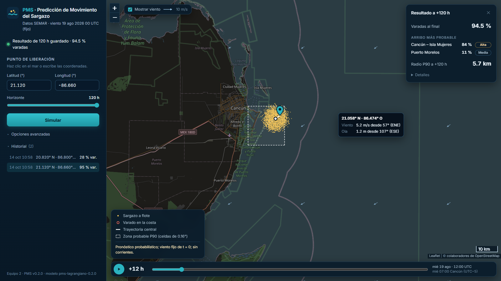
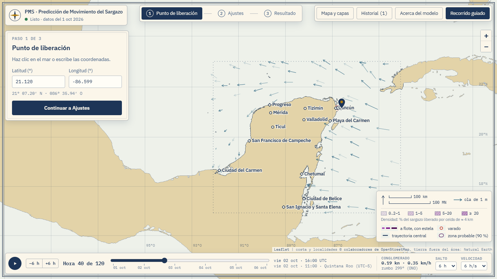

# PMS · Predicción de Movimiento del Sargazo

> **v0.2.0 — datos reales de SEMAR, interfaz mínima.** PMS simula la deriva probable de un
> conglomerado de sargazo con el viento que entrega SEMAR. Los datos actuales son
> **archivos de muestra** (una sola hora de viento y oleaje que no varía), no hay
> corrientes y los parámetros del modelo **no están calibrados**: el resultado es un
> pronóstico probabilístico para revisar con el equipo y con SEMAR, no para tomar
> decisiones operativas.



*Simulación de 120 h desde frente a Cancún con el viento de SEMAR del 19 ago 2026 00 UTC,
pausada en +12 h: partículas a flote, trayectoria central, contorno de la zona probable P90
en celdas de 0.16°, flechas de viento, hover con viento y ola del nodo más cercano y el
resumen del resultado.*

---

## Contenido

1. [Qué cambió en la v0.2.0](#qué-cambió-en-la-v020)
2. [Problema y contexto](#problema-y-contexto)
3. [Datos de SEMAR](#datos-de-semar)
4. [Cómo correrlo en Windows](#cómo-correrlo-en-windows-powershell)
5. [Qué se ve en la pantalla](#qué-se-ve-en-la-pantalla)
6. [El modelo](#el-modelo)
7. [Validación de los datos](#validación-de-los-datos)
8. [Ejemplo: 120 h frente a Cancún](#ejemplo-120-h-frente-a-cancún)
9. [API](#api)
10. [Mapa del repositorio](#mapa-del-repositorio)
11. [Pruebas y rendimiento medido](#pruebas-y-rendimiento-medido)
12. [Despliegue en Vercel](#despliegue-en-vercel)
13. [Límites honestos](#límites-honestos)
14. [Preguntas abiertas para SEMAR y el profesor](#preguntas-abiertas-para-semar-y-el-profesor)
15. [Siguientes pasos](#siguientes-pasos)
16. [Créditos y atribuciones](#créditos-y-atribuciones)

---

## Qué cambió en la v0.2.0

| | v0.1 (prototipo visual) | v0.2.0 |
|---|---|---|
| Datos | 120 archivos **sintéticos** generados por un script | `salidadatos.txt` y `dirmarea.txt` **reales de SEMAR**, en `data/semar/` (fuera de git) |
| Viento | Sintético, horario | SEMAR, **una sola hora** (19 ago 2026 00 UTC), usado fijo durante 120 h; el lector ya acepta N horas |
| Corrientes | Esquemáticas (inventadas) | **Ninguna**: u_c = 0. El término sigue implementado como entrada opcional (`data/semar/corrientes/`) |
| Oleaje | Solo dirección, sintética | Altura y dirección de SEMAR en validación, registro y hover; **no mueve partículas** |
| Modelo | `pms-lagrangiano-0.1.0` | `pms-lagrangiano-0.2.0`: X(t+Δt) = X + α·u_w·Δt + √(2·K_h·Δt)·ξ |
| Interfaz | Capa de densidad, malla, 6 casillas, gráfica, KPIs, bitácora | Estado en una línea, flechas de viento estáticas, partículas, trayectoria, contorno P90 y 3 cifras de resultado |

`scripts/generar_datos_demo.py` se reemplazó por `scripts/generar_fixtures.py`, que ya no
alimenta la app: solo genera archivos pequeños **en el formato real** para las pruebas.

## Problema y contexto

El sargazo pelágico (*Sargassum natans* y *S. fluitans*) flota gracias a vesículas de gas
y, desde 2011, forma el Gran Cinturón de Sargazo del Atlántico. Cuando llega a la costa del
Caribe mexicano afecta arrecifes, pastos marinos, anidamiento de tortugas, calidad del agua,
turismo e infraestructura. Anticipar su deriva ayuda a organizar el monitoreo y la
respuesta, pero el arribo a una playa concreta es difícil de predecir: por eso PMS presenta
**probabilidades** y no certezas.

Fuentes de referencia:

- **SEMAR – IOGMC**, boletines de seguimiento del sargazo (trayectorias a 24 y 48 h):
  <https://diredimoat.semar.gob.mx/OpSargazo/BoletinesSargazo.html>
- **USF – Sargassum Watch System (SaWS)**: <https://optics.marine.usf.edu/projects/saws.html>
- **NOAA – GNOME Suite** (modelo lagrangiano de referencia): <https://response.restoration.noaa.gov/gnomesuite>

## Datos de SEMAR

Los archivos son datos de la Secretaría de Marina entregados como muestra. **No hay permiso
para publicarlos**, así que `data/semar/*` está en `.gitignore`. Para usar PMS, copia en
`data/semar/` (detalle en [`data/semar/README.md`](data/semar/README.md)):

| Archivo | Contenido | Obligatorio |
|---|---|---|
| `salidadatos.txt` | `LON;LAT;sfcPrimWaDir;sfcDirWindWa;U;V;WindsfcSp;WindsfcDir`, línea de fecha `19AUG2026 00`, 60 501 filas: malla completa 301 × 201 de 0.16° (lon −124…−76, lat 39…7, de norte a sur) | Sí |
| `dirmarea.txt` | `LON;LAT;dirolavto;alturaolavto` (ola de viento: dirección «desde» y altura en m), 41 bloques `01OCT2026 00 h` con h = 0, 3, …, 120, cada uno con 4 794 filas: malla 94 × 51 (lon −98…−83.12, lat 23…15) | No |
| `corrientes/*.txt` | `LON;LAT;UO;VO` (m/s, hacia donde fluye). Aún no existe | No |

`-9.99e+08` es el valor de relleno (sin dato, normalmente tierra) y se convierte en NaN.

**Hallazgos de los archivos de muestra** (todos verificados por el validador y por
`tests/test_validador.py::test_datos_reales_de_semar` cuando los datos están presentes):

1. **Una sola hora de viento** (19 ago 2026 00 UTC). PMS la usa **fija** durante las 120 h.
2. **El oleaje no varía en el tiempo**: los 41 bloques de `dirmarea.txt` son idénticos byte por byte.
3. **Fechas distintas**: el oleaje es del 1 oct 2026 y el viento del 19 ago 2026.
4. **Malla de oleaje desplazada 0.08° en longitud** (−92.08, −91.92, …): se interpola de forma
   bilineal a la malla del modelo, ignorando NaN y promediando la dirección por seno y coseno.
5. En el dominio del modelo (lon −92…−84, lat 16.92…23; 51 × 39 = 1 989 nodos) hay **1 314
   nodos de mar con viento**; solo **1 045** tienen `sfcDirWindWa` (no hay mar de viento en
   todos los nodos, y no es error).
6. `WindsfcDir` coincide con atan2(−U, −V) con mediana de 0.02° → convención **«desde»**;
   |WindsfcSp − √(U²+V²)| ≤ 0.010 m/s; `sfcDirWindWa` difiere ~11° de `WindsfcDir`, así que el
   oleaje de viento usa la misma convención.
7. Viento en el dominio: 2.18–11.89 m/s (media 6.3 m/s); ola de viento: 0.10–2.78 m.
8. La máscara de mar de los datos y la costa poligonal del modelo difieren en 29 nodos
   (10 con viento sobre «tierra» del modelo, 19 sin viento sobre «mar» del modelo).

## Cómo correrlo en Windows (PowerShell)

Requisitos: Python 3.12 o superior (probado con 3.14.0), Git y conexión a internet para el
mapa base de OpenStreetMap.

```powershell
git clone https://github.com/renecano/sargazo_prototipo.git
cd sargazo_prototipo
python -m venv .venv
.\.venv\Scripts\Activate.ps1          # si se bloquea: Set-ExecutionPolicy -Scope Process -ExecutionPolicy Bypass
python -m pip install -r requirements-dev.txt

# Copia salidadatos.txt y dirmarea.txt de SEMAR en data\semar\
python main.py                        # abre http://localhost:8000
```

Opciones: `python main.py --puerto 8080 --no-navegador --datos D:\otra\carpeta --simulaciones D:\sims`.
Sin los archivos la app abre en el estado **Sin datos** y explica dónde colocarlos.

Pruebas y utilidades:

```powershell
python -m pytest                      # pruebas rápidas (no necesitan los datos de SEMAR)
python -m pytest -m e2e               # pruebas de interfaz con Playwright (usa Microsoft Edge)
python scripts/capturar_pantalla.py   # capturas de docs/ (necesita data/semar/)
python scripts/medir_rendimiento.py   # tiempos y memoria → docs/rendimiento.md (necesita data/semar/)
python scripts/generar_fixtures.py --destino tmp\fixture --completo   # fixture en formato SEMAR
```

## Qué se ve en la pantalla

El criterio de la v0.2.0: cada elemento visible sirve para decidir dónde liberar, simular o
leer el resultado.

- **Panel izquierdo**: título, fuente de los datos («Datos SEMAR · viento 19 ago 2026 00 UTC
  (fijo)»), **estado en una línea** (sin datos / validando / listo / calculando / resultado /
  error) con «Ver detalle» solo si hay errores o advertencias, punto de liberación (clic en el
  mapa o lat/lon), horizonte (24–120 h) y **Simular**. «Opciones avanzadas» (radio,
  partículas, α, K<sub>h</sub>, semilla) e **Historial** (fecha, punto, % varadas) están plegados.
- **Mapa**: flechas **estáticas** de viento en una submalla (largo ∝ velocidad, con un solo
  interruptor «Mostrar viento»), partículas a flote y varadas, trayectoria central y contorno
  de la zona probable P90 en celdas de 0.16°.
- **Hover** (requisito de SEMAR): latitud y longitud con 3 decimales, viento (m/s y dirección
  «desde») y ola (altura y dirección «desde») del nodo de malla más cercano.
- **Leyenda** de 4 elementos y el aviso «Pronóstico probabilístico; viento fijo de t = 0; sin
  corrientes».
- **Línea de tiempo**: reproducir/pausa a velocidad fija (6 h/s), deslizador 0–120 h, hora en
  UTC y en Cancún (UTC−5); teclas espacio, ← y →. La pausa conserva hora y posiciones.
- **Resultado**: % varadas al final, los 3 tramos de costa con mayor probabilidad de arribo
  (Alta ≥ 30 %, Media ≥ 10 %, Baja ≥ 2 %, Muy baja) y el radio P90 a +120 h; parámetros,
  huellas SHA-256 y advertencias en «Detalles».

| Datos validados, listo para simular | Datos con un error (falta la hora +57 del oleaje) |
|---|---|
|  |  |

## El modelo

`pms-lagrangiano-0.2.0`, enfoque de deriva superficial tipo GNOME, para cada partícula y
cada paso Δt = 1 h:

```
X(t+Δt) = X(t) + [ u_c(X,t) + α·u_w(X,t) ]·Δt + √(2·K_h·Δt)·ξ ,   ξ ~ N(0, 1)
con los datos actuales u_c = 0  →  X(t+Δt) = X(t) + α·u_w(X)·Δt + √(2·K_h·Δt)·ξ
```

| Símbolo | Significado | Valor | Estado |
|---|---|---|---|
| u<sub>w</sub> | Viento a 10 m de SEMAR, de *desde* a vector *hacia* (m/s) | `salidadatos.txt` | Una sola hora: estacionario |
| u<sub>c</sub> | Corriente superficial | 0 | **Sin datos**: entrada opcional para CMEMS/HYCOM |
| α | Arrastre del viento | 1 % (0–4 %) | **Preliminar**: supuesto del equipo, no proviene de SaWS |
| K<sub>h</sub> | Difusión horizontal | 10 m²/s | **Preliminar**: referencia de GNOME para hidrocarburos |
| Δt | Paso | 1 h | Fijo |

- **Por qué sin corrientes.** Las corrientes esquemáticas de la v0.1 eran inventadas; en una
  app con datos reales no deben aparecer datos simulados. Sin corrientes, el sargazo solo se
  mueve por α·u<sub>w</sub> (≈ 5 cm/s con viento de 5 m/s) y la difusión, lo que **subestima
  el transporte**: frente a Cancún la Corriente de Yucatán (más de 1 m/s) dominaría.
- **Por qué el oleaje no mueve partículas.** La deriva de Stokes depende de la altura **y del
  período** de la ola; `dirmarea.txt` no trae período, así que no hay una forma defendible de
  calcularla. El oleaje se valida, se guarda en el registro y se muestra en el hover. Es una
  decisión pendiente con el profesor.
- **Implementación**: interpolación bilineal en espacio que **descarta los nodos sin dato**
  (tierra) y renormaliza; lineal en el tiempo cuando haya varias horas; término determinista
  con punto medio (RK2); metros → grados con corrección por cos(lat); partícula **varada** en
  el último punto en mar del segmento (bisección); **fuera del dominio** si sale del recuadro;
  semilla para reproducibilidad.
- **Salidas**: centroide de las partículas a flote, radio P90 alrededor de él, zona probable
  P90 (menor conjunto de celdas de 0.16° con el 90 % de las partículas) y probabilidad de
  arribo por tramo de costa (fracción de partículas que varan en cada tramo).

## Validación de los datos

`src/ingestion/validador.py` revisa ambos archivos antes de permitir una simulación, no se
detiene en el primer error y reporta cada hallazgo con la causa, el archivo y la acción:

1. **Archivos**: falta `salidadatos.txt` → error; falta `dirmarea.txt` → advertencia; extensiones inesperadas.
2. **Formato**: encabezado y columnas requeridas, filas defectuosas (con número de línea), datos antes de la fecha.
3. **Fechas**: legibles (mapa propio de meses en inglés), bloques de viento en orden; advierte viento de una sola hora y fechas de viento y oleaje distintas.
4. **Malla**: regular de 0.16°, rectangular, igual en todos los bloques, y cobertura del dominio.
5. **Relleno**: `-9.99e+08` → NaN; las cuatro columnas de viento deben faltar juntas; cuenta los nodos de mar sin `sfcDirWindWa` (no es error).
6. **Rangos físicos**: viento 0–75 m/s, U y V ±75 m/s, direcciones 0–360°, altura de ola 0–20 m.
7. **Coherencia y convención**: |WindsfcSp − √(U²+V²)| ≤ 0.05 m/s y WindsfcDir vs atan2(−U, −V) (detecta la convención «hacia»).
8. **Oleaje**: horas +0, +3, …, +120 sin huecos, misma malla en todos los bloques, advertencia si todos son idénticos, interpolación de la malla desplazada.
9. **Máscara de mar vs costa del modelo**: cuántos nodos no coinciden.
10. **Corrientes**: si no hay, advierte que u<sub>c</sub> = 0; si hay, malla y magnitud ≤ 3 m/s.

Cada simulación guardada incluye la huella SHA-256 de `salidadatos.txt` y `dirmarea.txt`
(y de las corrientes si existen), las advertencias de los datos y la versión del modelo.

## Ejemplo: 120 h frente a Cancún

Liberación en 21.120° N, 86.660° O (≈ 8 km al este de la zona hotelera), con los valores por
defecto (2 000 partículas, radio 5 km, α = 1 %, K<sub>h</sub> = 10 m²/s, semilla 2026) y los
datos de SEMAR:

| Resultado | Valor |
|---|---|
| Varadas al final (+120 h) | **94.5 %** (5.5 % a flote, 0 % fuera del dominio) |
| Cancún – Isla Mujeres | **84 % · Alta** (primeras partículas a +13 h, mediana +60 h) |
| Puerto Morelos | **11 % · Media** (primeras a +60 h, mediana +99 h) |
| Radio P90 | 5.7 km a +24 h, 6.1 km a +48 h, 5.7 km a +120 h |
| Centroide | 21.3 km recorridos hacia el SO |

El viento de SEMAR viene del ENE (≈ 55–58°, ~5 m/s) frente a Cancún y empuja el
conglomerado hacia la costa. Con u<sub>c</sub> = 0 este resultado **no considera la Corriente
de Yucatán** y no debe leerse como pronóstico operativo.

## API

| Método y ruta | Uso |
|---|---|
| `GET /api/salud` | Estado del servidor, versiones, si hay datos y si hay trabajos en segundo plano |
| `GET /api/validacion` · `POST /api/validacion` | Validación síncrona (usa caché) o en segundo plano con progreso |
| `GET /api/campos` | Viento y oleaje en la malla del modelo, compactos, para flechas y hover |
| `GET /api/costa` | Costa del modelo y tramos de arribo (GeoJSON) |
| `POST /api/simulaciones` | Simula de forma síncrona, guarda y devuelve el registro |
| `POST /api/trabajos/simulacion` · `GET /api/trabajos/{id}` | Igual, en segundo plano, con progreso por hora |
| `GET /api/simulaciones` · `GET /api/simulaciones/{id}` | Historial y registro completo |

Los errores llegan como `{"detail": {"causa", "accion", "archivo"}}`: 409 datos no válidos,
422 parámetros o punto en tierra, 404 id inexistente. Documentación interactiva en `/docs`.

## Mapa del repositorio

```
sargazo_prototipo/
├── main.py                       python main.py → http://localhost:8000
├── api/index.py · vercel.json    Función sin servidor para Vercel
├── data/
│   ├── semar/                    Datos de SEMAR (fuera de git; solo README.md versionado)
│   └── simulations/              Simulaciones guardadas (JSON)
├── src/
│   ├── config.py                 Dominio, malla, archivos de SEMAR, versiones
│   ├── ingestion/                lector.py (formato SEMAR, relleno, interpolación) · validador.py
│   ├── model/                    conversiones · campos · simulacion · costa · metricas
│   ├── api/                      app.py · servicios.py · almacen.py
│   └── view/                     index.html · css/ · js/ · vendor/leaflet
├── scripts/                      generar_fixtures.py · capturar_pantalla.py · medir_rendimiento.py
├── tests/                        Pruebas rápidas + tests/e2e/ (Playwright)
├── docs/                         Capturas y rendimiento medido
└── .github/workflows/ci.yml      CI: Windows y Ubuntu, Python 3.12 y 3.14, + e2e
```

## Pruebas y rendimiento medido

`python -m pytest` corre **97 pruebas rápidas** (96 + 1 que verifica los datos reales y se
omite si no están en `data/semar/`, como en el CI) y `python -m pytest -m e2e` corre **13 de
interfaz**; todas en verde al cierre de esta versión. Las pruebas no dependen de los datos de SEMAR: usan fixtures generados en
el formato real.

| Archivo | Qué comprueba |
|---|---|
| `tests/test_lector.py` | Fechas `DDMMMAAAA HH [h]` (incluidas ilegibles), lectura de ambos formatos, relleno −9.99e+08 → NaN, 41 bloques, filas defectuosas, malla norte→sur, interpolación desplazada que ignora NaN, dirección por seno/coseno |
| `tests/test_validador.py` | Fixture válido con sus advertencias; bloques idénticos y fechas distintas solo cuando lo son; oleaje desplazado interpolado correctamente; archivo faltante, fecha ilegible, columna ausente, rangos, incoherencia U/V, convención invertida, relleno inconsistente, malla no rectangular, hora de oleaje faltante, altura fuera de rango, máscara vs costa, corrientes opcionales, varias horas de viento; datos reales (si existen) |
| `tests/test_modelo.py` | Solución analítica con viento y K<sub>h</sub> = 0, corriente opcional, **viento estacionario igual en t = 0 y t = 120**, interpolación temporal con varias horas, nodos de tierra ignorados, reproducibilidad, dispersión √(2·K<sub>h</sub>·t), ninguna partícula sobre tierra, dominio, métricas |
| `tests/test_api.py` | Simulación → 200, guardada con la huella de ambos archivos e historial; trabajos con progreso; 409/422/404; estado sin datos |
| `tests/e2e/test_interfaz.py` | Validación y detalle plegable, interfaz mínima, flechas estáticas y ocultables, clic para liberar, 120 h frente a Cancún, pausa que conserva hora y posición, teclas y hora UTC/Cancún, hover con viento y ola, historial, punto en tierra, datos inválidos y sin datos |

Rendimiento con los datos de SEMAR (Windows 11, 8 GB de RAM con 1.1 GB libres al medir;
detalle en [`docs/rendimiento.md`](docs/rendimiento.md)): validar ambos archivos **0.38 s**;
simular 2 000 partículas × 120 h **0.21 s** y 5 000 **0.30 s**; registro JSON 1.3 MB (2 000)
o 3.1 MB (5 000).

## Despliegue en Vercel

El proyecto de Vercel `pms-sargazo` está **conectado a GitHub** (despliega `main` en
<https://pms-sargazo.vercel.app>). Como `data/semar/` no está en git, los despliegues desde
GitHub **no llevan los datos de SEMAR** y la app muestra el estado **Sin datos**. Es
intencional: no hay permiso para publicar esos archivos, y un despliegue público los
expondría a través de `/api/campos`.

`vercel.json` ya incluye `data/semar/**` en la función, por si se decide desplegar desde la
CLI (`vercel deploy --prod`, que sube los archivos locales) **con autorización de SEMAR** y,
de preferencia, con la protección de despliegues de Vercel activada. En Vercel el historial
vive en `/tmp` (efímero) y la interfaz usa los endpoints síncronos.

## Límites honestos

- **Viento de una sola hora**, usado fijo 120 h: no hay evolución del viento.
- **Sin corrientes**: falta el principal mecanismo de transporte frente a Quintana Roo; las
  distancias recorridas y la proporción de varado no son realistas.
- **Oleaje de muestra**: no varía en las 41 horas, su fecha no coincide con la del viento y no
  entra al movimiento (sin período no hay deriva de Stokes).
- **Parámetros sin calibrar** (α y K<sub>h</sub>) y **sin validación contra observaciones**.
- **Costa aproximada** (decenas de vértices) que difiere de la máscara de SEMAR en 29 nodos;
  la malla de 0.16° (~17 km) no resuelve procesos costeros.
- **Dominio limitado** al recuadro de Yucatán; liberación única en t = 0; sin biología.
- **Infraestructura mínima**: JSON en disco, sin usuarios ni autenticación, sin carga de
  archivos desde la interfaz. Hay CI, pero no pipelines de despliegue dev/prod, y la demo en
  Vercel queda sin datos por la restricción de publicación.

## Preguntas abiertas para SEMAR y el profesor

1. ¿Pueden entregar el **pronóstico de viento horario completo** (120 h) y no solo t = 0?
2. ¿`dirmarea.txt` de muestra debía variar en el tiempo? ¿Por qué su fecha (1 oct) no coincide
   con la del viento (19 ago)? ¿Por qué se llama «mareas» si trae oleaje de viento?
3. ¿Hay **período de ola** (o espectro) para estimar la deriva de Stokes?
4. ¿Qué fuente de **corrientes** usan en sus boletines (CMEMS, HYCOM u otra) y con qué
   resolución temporal?
5. ¿La malla de `dirmarea.txt` desplazada 0.08° es intencional (centros de celda)?
6. ¿Qué valores de α (arrastre del viento) usan para sargazo?
7. ¿Autorizan publicar los datos o una versión derivada en una demo pública?

## Siguientes pasos

1. Corrientes CMEMS/HYCOM en `data/semar/corrientes/` (la ingesta y el modelo ya las aceptan).
2. Pronóstico de viento de 120 h (el lector ya interpola entre varias horas).
3. Decidir con el profesor si se incluye la deriva de Stokes cuando haya período de ola.
4. Calibrar α y K<sub>h</sub> contra los boletines de SEMAR a 24/48 h y medir el error de distancia.
5. Persistencia real, autenticación y despliegue autorizado.

## Créditos y atribuciones

**Equipo 2** — Marco Aurelio Tamez Robles · Claudia Vanessa Hermosillo Díaz ·
René Emiliano Cano Fuentes · Alan Yael García Velázquez · José Luis Socorro Martínez ·
José Ángel Vargas Carranza.

- Datos de viento y oleaje: **Secretaría de Marina (SEMAR)**, archivos de muestra, no publicados.
- Mapa base © [colaboradores de OpenStreetMap](https://www.openstreetmap.org/copyright) (ODbL).
- [Leaflet](https://leafletjs.com) 1.9.4 (BSD-2-Clause), incluido en `src/view/vendor/leaflet/`.
- Tipografía [Inter](https://rsms.me/inter/) vía Google Fonts (SIL Open Font License).

Código bajo licencia [MIT](LICENSE).
