# ¿El modelo se mueve como el sargazo real? — Validación de PMS v0.4.0

> Generado por `python scripts/validar.py` el 2026-11-01 01:13 UTC. Cada número de este documento sale de ese script; las tablas completas están en [`docs/validacion/`](validacion/).

## Conclusión

**Con datos satelitales 2022–2026, el modelo v0.3 (solo oleaje) no se distingue de suponer que el sargazo no se mueve; ni agregando corrientes (E4 Corriente SMOC total + browniano) se supera a la persistencia.**

Medido en 11 casos de evaluación (2025–2026) que no se usaron para calibrar, con el Fractions Skill Score a 25 km entre el sargazo que vio el satélite y el que simula el modelo a +3, +5 y +7 días. El modelo v0.3 (E2) no se distingue de la persistencia (+3 d: indistinguible; +5 d: indistinguible; +7 d: indistinguible).

| Experimento | +3 d | +5 d | +7 d |
|---|---|---|---|
| E0 Persistencia | 0.375 [0.291–0.452] | 0.354 [0.272–0.424] | 0.364 [0.308–0.411] |
| E1 Solo browniano | 0.379 [0.294–0.455]<br>Δ vs E0 +0.004 [-0.001, +0.010] | 0.357 [0.275–0.429]<br>Δ vs E0 +0.003 [-0.004, +0.012] | 0.371 [0.313–0.420]<br>Δ vs E0 +0.007 [+0.001, +0.014] |
| E2 PMS v0.3 | 0.377 [0.296–0.449]<br>Δ vs E0 +0.002 [-0.017, +0.024] | 0.332 [0.254–0.404]<br>Δ vs E0 -0.022 [-0.045, +0.001] | 0.345 [0.280–0.410]<br>Δ vs E0 -0.019 [-0.055, +0.018] |
| E3 PMS calibrado | 0.378 [0.293–0.454]<br>Δ vs E0 +0.003 [-0.004, +0.009] | 0.352 [0.270–0.423]<br>Δ vs E0 -0.002 [-0.009, +0.006] | 0.363 [0.307–0.409]<br>Δ vs E0 -0.001 [-0.006, +0.005] |
| E4 Corriente SMOC total + browniano | 0.359 [0.270–0.437]<br>Δ vs E0 -0.016 [-0.077, +0.049] | 0.283 [0.215–0.346]<br>Δ vs E0 -0.071 [-0.134, -0.006] | 0.254 [0.190–0.315]<br>Δ vs E0 -0.110 [-0.165, -0.049] |
| E5 Corriente sin Stokes + viento 1 % + ola | 0.342 [0.261–0.416]<br>Δ vs E0 -0.033 [-0.091, +0.025] | 0.269 [0.200–0.333]<br>Δ vs E0 -0.085 [-0.144, -0.020] | 0.226 [0.162–0.289]<br>Δ vs E0 -0.138 [-0.187, -0.084] |
| E5 Corriente sin Stokes + viento 2 % + ola | 0.297 [0.227–0.366]<br>Δ vs E0 -0.078 [-0.125, -0.034] | 0.255 [0.186–0.317]<br>Δ vs E0 -0.099 [-0.152, -0.041] | 0.199 [0.137–0.259]<br>Δ vs E0 -0.165 [-0.209, -0.122] |
| E5 Corriente sin Stokes + viento 3 % + ola | 0.282 [0.213–0.351]<br>Δ vs E0 -0.093 [-0.145, -0.045] | 0.227 [0.169–0.280]<br>Δ vs E0 -0.126 [-0.173, -0.077] | 0.182 [0.122–0.244]<br>Δ vs E0 -0.182 [-0.228, -0.136] |

FSS: 1 = coincidencia perfecta, 0 = ninguna. Entre corchetes, intervalo de confianza del 95 % por bootstrap de casos (2000 remuestreos). Δ vs E0: diferencia pareada caso a caso contra la persistencia; si su intervalo no incluye 0, la diferencia es real con esos casos.

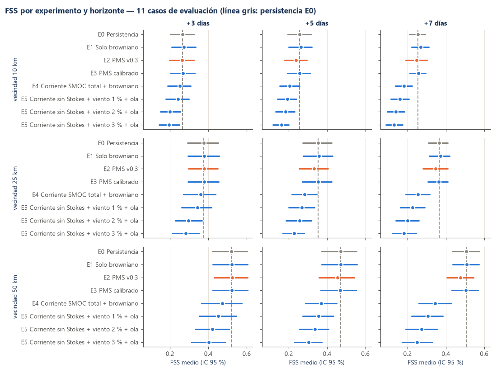

## La pregunta

El profesor preguntó: *¿cómo sabemos que ese comportamiento del sargazo es real?* La respuesta honesta es compararlo contra cómo se movió el sargazo de verdad. Este módulo toma días con sargazo visto por satélite, siembra partículas donde estaba, las mueve con el modelo usando el oleaje real de esas fechas y compara contra lo que el satélite vio 3, 5 y 7 días después. La referencia mínima es la **persistencia** (suponer que el sargazo no se mueve): un modelo que no le gana no aporta información sobre el movimiento.

El producto no cambia: sigue usando solo `dirmarea.txt`. La validación genera `dirmarea.txt` reales en el mismo formato y los pasa por el mismo validador, lector e integrador del producto.

## Fuentes

Detalle completo (URL, IDs, variables, licencias, fechas de descarga y limitaciones) en [`docs/fuentes_validacion.md`](fuentes_validacion.md).

| Qué | Fuente | Uso |
|---|---|---|
| Sargazo observado | AFAI diario de USF (C. Hu), NOAA AOML ERDDAP `noaa_aoml_atlantic_oceanwatch_AFAI_1D`, 0.015° | Verdad |
| Ola de viento | Copernicus Marine, MFWAM: `cmems_mod_glo_wav_anfc_0.083deg_PT3H-i` (0.083°, desde nov 2022); antes, reanálisis `cmems_mod_glo_wav_my_0.2deg_PT3H-i` (0.2°) | dirmarea.txt real (E1–E3, E5) |
| Corriente superficial | Copernicus Marine, SMOC: `cmems_mod_glo_phy_anfc_merged-uv_PT1H-i` (0.083°, 1 h) | E4 (total), E5 (sin Stokes) |
| Viento a 10 m | Open-Meteo histórico, ERA5 (`era5`), 0.25° | E5 |

*Generated using E.U. Copernicus Marine Service Information; https://doi.org/10.48670/moi-00017, https://doi.org/10.48670/moi-00022, https://doi.org/10.48670/moi-00016.*

Qué fuente usó cada caso: columnas `fuente_oleaje`, `oleaje_resolucion_grados`, `fuente_corriente` y `fuente_viento` de [`casos.csv`](validacion/casos.csv). Hasta la versión anterior de este módulo el oleaje y la corriente venían de Open-Meteo, que cobra cada punto como una llamada; la validación quedó bloqueada por su cuota diaria y se rehizo completa con Copernicus Marine, sin mezclar fuentes.

La detección de Sentinel-3 OLCI (Debue et al., ESSD 2026) quedó como segunda opinión pendiente: ver fuentes.

## Método

### Sargazo observado

Se sigue a Wang & Hu (2016, *Remote Sensing of Environment* 183:350-367): ΔAFAI = AFAI − fondo, con el fondo = mediana en una ventana de 51 × 51 píxeles que excluye los candidatos (ΔAFAI preliminar > 2.55e-04); un píxel tiene sargazo si **ΔAFAI > 1.79e-04**, el umbral con el que esos autores capturan ~95 % de los píxeles con sargazo y confunden ~10 % de los vecinos sin sargazo. Diferencias con el artículo: el fondo sale de dos pasadas de mediana (sin el ajuste polinómico previo) y no hay máscara de sombra de nube.

- **Nubes y píxeles sin dato**: AOML entrega NaN donde hay nube, brillo solar o tierra; además se descartan 2 píxeles alrededor de cada nube (efecto de adyacencia). Un píxel con nube en la imagen de destino no cuenta ni para lo observado ni para lo simulado.
- **Mar evaluado**: 125 564 píxeles de ~1.6 km. Se excluyen la tierra del modelo, los píxeles observados menos de 30 veces en 2022–2026 (AOML no cubre la franja al sur de 21° N y al oeste de 90.5° O) y **5 409 píxeles brillantes persistentes** (sobre el umbral en ≥ 20% de sus observaciones: fondo somero, turbidez, arrecifes; el sargazo se mueve, un fondo no).
- **Umbral adaptado al ruido**: en este producto el ruido de ΔAFAI en el Caribe es del orden de T0, así que con T0 solo una parte grande del mar saldría con «sargazo» aun sin temporada. Por eso se exige además ΔAFAI > 3σ, con σ = 1.4826 × MAD de ΔAFAI en la misma ventana (umbral local por la distribución de la ventana, como Garcia et al., 2013, citado por Wang & Hu). Se fijó antes de correr cualquier experimento. Aun así queda ruido: la mediana mensual de la fracción de píxeles despejados con «sargazo» va de 1.9 % (2023-11) a 11.7 % (2026-07); el mes más bajo acota el piso de ruido ([`inventario_mensual.csv`](validacion/inventario_mensual.csv)).
- **Dos regiones del producto**: el AFAI de AOML une dos regiones con ruido distinto y bordes rectos en 22.0° N y 90.0° O (salto brusco en la frecuencia de detección y en el número de observaciones). El fondo y el ruido se estiman por región; mezclarlas crea una franja falsa de «sargazo» junto a la costura que, por estar fija, favorecería a la persistencia. Aun así, del lado «Caribe» la frecuencia de detección sube de forma monótona en los 25 píxeles junto a la costura (de ~6 % a ~26 %; al otro lado se queda en 2–3 %): es un artefacto de los valores del producto en el borde y esa franja se excluye.

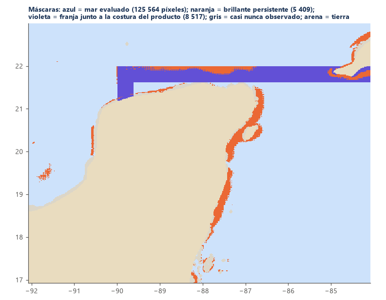

### Oleaje real en el formato de SEMAR

`scripts/generar_dirmarea.py` toma la ola de viento de MFWAM de Copernicus Marine a su resolución nativa (VHM0_WW, VMDR_WW «desde»), la interpola de forma bilineal a los nodos de 0.16° y escribe un `dirmarea.txt` idéntico en formato al de SEMAR: misma malla de 94 × 51 nodos, mismas columnas LON;LAT byte a byte, 41 bloques +0…+120 h, mismo relleno `-9.99e+08` en tierra (los nodos fuera del recuadro del modelo quedan con relleno). El validador del producto lo acepta sin cambios. Para llegar a +7 días se encadenan dos archivos (fecha base t0 y t0 + 5 d), cada uno validado por el producto. La corriente de SMOC se usa a su resolución nativa (0.083°, horaria), sin pasar por la malla de 0.16°.

**Período y deriva de Stokes, verificados con el producto de oleaje** (25 casos, nodos del modelo cada 3 h de t0 a t0 + 7 d; mediana por caso y, entre paréntesis, el rango entre casos):

- T_real (VTM01_WW) / T_supuesto (4.0·√H): 1.01 (0.97–1.08).
- Deriva de Stokes del producto (VSDX, VSDY; espectro completo, con mar de fondo) / fórmula del modelo con T supuesto: 1.01 (0.84–1.10); con el T real de la ola de viento: 1.00 (0.96–1.07).
- Diferencia de dirección entre la deriva del producto y la del modelo: 5° (3°–7°).

Un cociente distinto de 1 dice cuánto se aleja la deriva del modelo (solo ola de viento, fórmula de aguas profundas) de la que calcula el propio modelo de oleaje con todo el espectro; por caso en [`casos.csv`](validacion/casos.csv).

### Casos

Se revisaron 1757 días (2022-01-01 a 2026-10-30 menos 7 días). Un día es candidato si tiene ≥ 150 píxeles con sargazo, ≥ 50% del mar despejado, imagen a +3, +5 y +7 días con ≥ 40% despejado y ≥ 40% despejado a ≤ 50 km del sargazo inicial. Los casos no comparten imágenes (t0 separados más de 7 días); se eligen de mayor a menor calidad. Hubo **66 días candidatos y 25 casos**: 14 de calibración (t0 antes de 2025-01-01) y 11 de evaluación (2025–2026). La separación por fechas se fijó antes de correr.

| Motivo de descarte (primer criterio que falla) | Días |
|---|---|
| Sin imagen AFAI ese día | 16 |
| Menos de 150 píxeles con sargazo en t0 | 125 |
| Menos de 50% del mar despejado en t0 | 1252 |
| Falta la imagen de +3, +5 o +7 días | 1 |
| Menos de 40% del mar despejado a +3, +5 o +7 días | 292 |
| Menos de 40% despejado a ≤ 50 km del sargazo a +3, +5 o +7 días | 5 |
| Comparte imágenes con un caso de mejor calidad (t0 a 7 días o menos) | 41 |

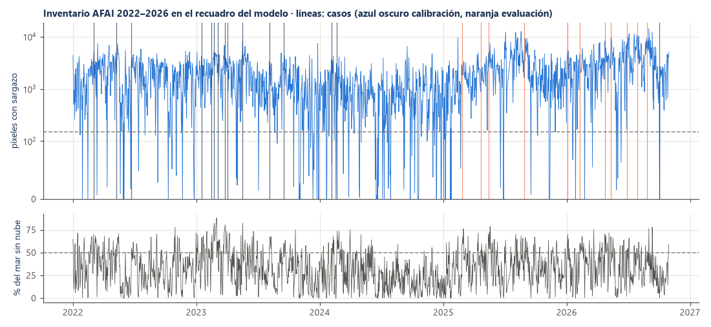

Lista de casos: [`docs/validacion/casos.csv`](validacion/casos.csv).

### Experimentos

Todos con las mismas 20 000 partículas (o una por píxel si hay más píxeles), sembradas en proporción a los píxeles con sargazo en t0 (cada píxel pesa 1), la misma semilla (2026) y el integrador del producto (Δt = 1 h, RK2, costa y varamiento iguales). La simulación empieza a las 18 UTC (hora aproximada de la imagen).

| | Qué mueve las partículas |
|---|---|
| E0 | Nada: persistencia |
| E1 | Solo browniano (γ = 0, K_h = 10 m²/s) |
| E2 | PMS v0.3 tal cual: deriva de Stokes de la ola real (γ = 1, K_h = 10) |
| E3 | PMS con γ = 0 y K_h = 1, elegidos con los 14 casos de calibración (rejilla γ ∈ [0.0, 0.5, 1.0, 1.5, 2.0, 3.0], K_h ∈ [1.0, 10.0, 50.0, 100.0], máximo FSS 25 km medio) |
| E4 | Corriente superficial total de SMOC (euleriana + marea + deriva de Stokes) + browniano (experimental) |
| E5 | Corriente de SMOC sin Stokes (euleriana + marea) + 1 %, 2 % o 3 % del viento a 10 m + ola del modelo (γ = 1) (experimental) |

SMOC entrega por separado la corriente euleriana (uo, vo), la marea (utide, vtide) y la deriva de Stokes (vsdx, vsdy), y utotal = uo + utide + vsdx. Por eso E4 usa la corriente total y E5 la corriente sin Stokes: en E5 la deriva por oleaje la pone la ola del modelo y no se cuenta dos veces.

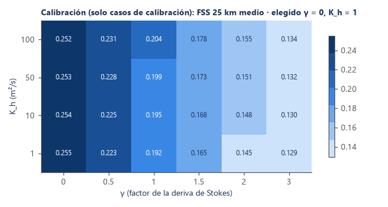

### Métricas

- **FSS** (Roberts & Lean, 2008) a 10 km, 25 km, 50 km (ventanas de 7 px ≈ 11 km, 15 px ≈ 24 km, 31 px ≈ 50 km). Observado = 1 en los píxeles con sargazo; simulado = suma de pesos de las partículas a flote en el píxel (máx. 1). Solo píxeles despejados en la imagen de destino.
- **Centroide**: distancia entre el centroide observado y el simulado (mismos píxeles despejados), y error de dirección del desplazamiento respecto a E0 cuando lo observado se movió ≥ 5 km.
- **MCC**: correlación cruzada máxima normalizada con máscara (Padfield, 2012) de ΔAFAI entre imágenes de días consecutivos, plantillas de 21 px y búsqueda ± 40 px; se acepta con correlación ≥ 0.5. Se compara con el desplazamiento de 24 h del modelo desde el mismo punto y se resume con el skill score de Liu & Weisberg (2011) con trayectorias de un solo tramo (no hay boyas en los casos).
- **Costa**: por tramo de costa del modelo, ¿hay ≥ 3 píxeles con sargazo a ≤ 10 km de la costa en la imagen? Simulado: partículas varadas en el tramo más las que flotan en esa banda. Solo tramos con ≥ 30 % de su banda despejada.

## Resultados

### FSS en los 11 casos de evaluación

**Vecindad de 10 km**

| Experimento | +3 d | +5 d | +7 d |
|---|---|---|---|
| E0 Persistencia | 0.264 [0.201–0.325] | 0.257 [0.195–0.314] | 0.254 [0.210–0.293] |
| E1 Solo browniano | 0.273 [0.208–0.333]<br>Δ vs E0 +0.009 [+0.004, +0.014] | 0.264 [0.199–0.320]<br>Δ vs E0 +0.007 [-0.002, +0.017] | 0.268 [0.222–0.310]<br>Δ vs E0 +0.015 [+0.008, +0.022] |
| E2 PMS v0.3 | 0.262 [0.198–0.323]<br>Δ vs E0 -0.003 [-0.021, +0.015] | 0.236 [0.176–0.293]<br>Δ vs E0 -0.020 [-0.045, +0.004] | 0.246 [0.190–0.302]<br>Δ vs E0 -0.008 [-0.041, +0.027] |
| E3 PMS calibrado | 0.268 [0.204–0.329]<br>Δ vs E0 +0.004 [-0.001, +0.009] | 0.256 [0.193–0.312]<br>Δ vs E0 -0.000 [-0.007, +0.006] | 0.256 [0.212–0.295]<br>Δ vs E0 +0.002 [-0.001, +0.006] |
| E4 Corriente SMOC total + browniano | 0.251 [0.186–0.308]<br>Δ vs E0 -0.013 [-0.059, +0.034] | 0.205 [0.153–0.256]<br>Δ vs E0 -0.052 [-0.107, +0.005] | 0.181 [0.135–0.223]<br>Δ vs E0 -0.073 [-0.114, -0.026] |
| E5 Corriente sin Stokes + viento 1 % + ola | 0.241 [0.178–0.297]<br>Δ vs E0 -0.023 [-0.071, +0.023] | 0.192 [0.140–0.241]<br>Δ vs E0 -0.065 [-0.116, -0.010] | 0.160 [0.113–0.208]<br>Δ vs E0 -0.094 [-0.132, -0.051] |
| E5 Corriente sin Stokes + viento 2 % + ola | 0.200 [0.149–0.253]<br>Δ vs E0 -0.065 [-0.103, -0.028] | 0.183 [0.131–0.230]<br>Δ vs E0 -0.073 [-0.123, -0.022] | 0.139 [0.094–0.184]<br>Δ vs E0 -0.115 [-0.148, -0.083] |
| E5 Corriente sin Stokes + viento 3 % + ola | 0.193 [0.144–0.248]<br>Δ vs E0 -0.071 [-0.114, -0.034] | 0.161 [0.117–0.200]<br>Δ vs E0 -0.096 [-0.139, -0.054] | 0.128 [0.085–0.173]<br>Δ vs E0 -0.126 [-0.161, -0.091] |

**Vecindad de 25 km**

| Experimento | +3 d | +5 d | +7 d |
|---|---|---|---|
| E0 Persistencia | 0.375 [0.291–0.452] | 0.354 [0.272–0.424] | 0.364 [0.308–0.411] |
| E1 Solo browniano | 0.379 [0.294–0.455]<br>Δ vs E0 +0.004 [-0.001, +0.010] | 0.357 [0.275–0.429]<br>Δ vs E0 +0.003 [-0.004, +0.012] | 0.371 [0.313–0.420]<br>Δ vs E0 +0.007 [+0.001, +0.014] |
| E2 PMS v0.3 | 0.377 [0.296–0.449]<br>Δ vs E0 +0.002 [-0.017, +0.024] | 0.332 [0.254–0.404]<br>Δ vs E0 -0.022 [-0.045, +0.001] | 0.345 [0.280–0.410]<br>Δ vs E0 -0.019 [-0.055, +0.018] |
| E3 PMS calibrado | 0.378 [0.293–0.454]<br>Δ vs E0 +0.003 [-0.004, +0.009] | 0.352 [0.270–0.423]<br>Δ vs E0 -0.002 [-0.009, +0.006] | 0.363 [0.307–0.409]<br>Δ vs E0 -0.001 [-0.006, +0.005] |
| E4 Corriente SMOC total + browniano | 0.359 [0.270–0.437]<br>Δ vs E0 -0.016 [-0.077, +0.049] | 0.283 [0.215–0.346]<br>Δ vs E0 -0.071 [-0.134, -0.006] | 0.254 [0.190–0.315]<br>Δ vs E0 -0.110 [-0.165, -0.049] |
| E5 Corriente sin Stokes + viento 1 % + ola | 0.342 [0.261–0.416]<br>Δ vs E0 -0.033 [-0.091, +0.025] | 0.269 [0.200–0.333]<br>Δ vs E0 -0.085 [-0.144, -0.020] | 0.226 [0.162–0.289]<br>Δ vs E0 -0.138 [-0.187, -0.084] |
| E5 Corriente sin Stokes + viento 2 % + ola | 0.297 [0.227–0.366]<br>Δ vs E0 -0.078 [-0.125, -0.034] | 0.255 [0.186–0.317]<br>Δ vs E0 -0.099 [-0.152, -0.041] | 0.199 [0.137–0.259]<br>Δ vs E0 -0.165 [-0.209, -0.122] |
| E5 Corriente sin Stokes + viento 3 % + ola | 0.282 [0.213–0.351]<br>Δ vs E0 -0.093 [-0.145, -0.045] | 0.227 [0.169–0.280]<br>Δ vs E0 -0.126 [-0.173, -0.077] | 0.182 [0.122–0.244]<br>Δ vs E0 -0.182 [-0.228, -0.136] |

**Vecindad de 50 km**

| Experimento | +3 d | +5 d | +7 d |
|---|---|---|---|
| E0 Persistencia | 0.520 [0.420–0.603] | 0.472 [0.371–0.552] | 0.507 [0.433–0.572] |
| E1 Solo browniano | 0.523 [0.423–0.606]<br>Δ vs E0 +0.003 [-0.004, +0.010] | 0.471 [0.371–0.555]<br>Δ vs E0 -0.000 [-0.009, +0.009] | 0.508 [0.435–0.573]<br>Δ vs E0 +0.001 [-0.006, +0.008] |
| E2 PMS v0.3 | 0.525 [0.429–0.604]<br>Δ vs E0 +0.006 [-0.012, +0.026] | 0.455 [0.358–0.541]<br>Δ vs E0 -0.017 [-0.037, +0.004] | 0.476 [0.404–0.544]<br>Δ vs E0 -0.031 [-0.052, -0.007] |
| E3 PMS calibrado | 0.521 [0.422–0.605]<br>Δ vs E0 +0.001 [-0.007, +0.010] | 0.467 [0.366–0.550]<br>Δ vs E0 -0.005 [-0.013, +0.005] | 0.503 [0.430–0.568]<br>Δ vs E0 -0.004 [-0.011, +0.005] |
| E4 Corriente SMOC total + browniano | 0.474 [0.364–0.574]<br>Δ vs E0 -0.046 [-0.115, +0.023] | 0.370 [0.286–0.449]<br>Δ vs E0 -0.102 [-0.174, -0.023] | 0.345 [0.260–0.428]<br>Δ vs E0 -0.162 [-0.216, -0.103] |
| E5 Corriente sin Stokes + viento 1 % + ola | 0.452 [0.352–0.545]<br>Δ vs E0 -0.067 [-0.133, -0.008] | 0.356 [0.272–0.434]<br>Δ vs E0 -0.116 [-0.185, -0.038] | 0.306 [0.221–0.384]<br>Δ vs E0 -0.201 [-0.249, -0.151] |
| E5 Corriente sin Stokes + viento 2 % + ola | 0.422 [0.330–0.507]<br>Δ vs E0 -0.098 [-0.157, -0.042] | 0.336 [0.256–0.408]<br>Δ vs E0 -0.136 [-0.199, -0.069] | 0.272 [0.189–0.353]<br>Δ vs E0 -0.235 [-0.281, -0.191] |
| E5 Corriente sin Stokes + viento 3 % + ola | 0.403 [0.311–0.487]<br>Δ vs E0 -0.117 [-0.181, -0.057] | 0.303 [0.230–0.372]<br>Δ vs E0 -0.169 [-0.221, -0.110] | 0.249 [0.171–0.329]<br>Δ vs E0 -0.258 [-0.307, -0.206] |

FSS «útil» de Roberts & Lean (0.5 + f₀/2) en estos casos: 0.537 de media.

Con los 14 casos de calibración y con todos los casos: [`fss_resumen.csv`](validacion/fss_resumen.csv).

### Centroide y dirección (evaluación)

| Experimento | Horizonte | Error de centroide (km) | Δ vs E0 (km) | Error de dirección mediano | Varado / fuera |
|---|---|---|---|---|---|
| E0 Persistencia | +3 d | 83 [66–100] | 0 [0, 0] | —° (n = 0) | 0 % / 0 % |
| E0 Persistencia | +5 d | 112 [77–150] | 0 [0, 0] | —° (n = 0) | 0 % / 0 % |
| E0 Persistencia | +7 d | 70 [46–99] | 0 [0, 0] | —° (n = 0) | 0 % / 0 % |
| E1 Solo browniano | +3 d | 82 [64–98] | -2 [-3, -0] | 33° (n = 11) | 0 % / 1 % |
| E1 Solo browniano | +5 d | 110 [75–147] | -3 [-3, -2] | 46° (n = 10) | 0 % / 1 % |
| E1 Solo browniano | +7 d | 71 [46–99] | 0 [-1, 3] | 105° (n = 10) | 0 % / 1 % |
| E2 PMS v0.3 | +3 d | 85 [66–104] | 2 [-2, 7] | 107° (n = 11) | 1 % / 1 % |
| E2 PMS v0.3 | +5 d | 109 [74–146] | -3 [-10, 4] | 79° (n = 11) | 2 % / 2 % |
| E2 PMS v0.3 | +7 d | 75 [48–106] | 5 [-5, 16] | 76° (n = 11) | 5 % / 2 % |
| E3 PMS calibrado | +3 d | 82 [65–98] | -1 [-3, 0] | 53° (n = 9) | 0 % / 1 % |
| E3 PMS calibrado | +5 d | 111 [76–148] | -1 [-2, -1] | 53° (n = 8) | 0 % / 1 % |
| E3 PMS calibrado | +7 d | 70 [46–98] | -0 [-1, 1] | 63° (n = 9) | 0 % / 1 % |
| E4 Corriente SMOC total + browniano | +3 d | 106 [77–135] | 23 [8, 38] | 141° (n = 11) | 3 % / 14 % |
| E4 Corriente SMOC total + browniano | +5 d | 137 [91–183] | 25 [-10, 54] | 132° (n = 11) | 6 % / 23 % |
| E4 Corriente SMOC total + browniano | +7 d | 125 [75–177] | 54 [17, 95] | 107° (n = 11) | 9 % / 32 % |
| E5 Corriente sin Stokes + viento 1 % + ola | +3 d | 116 [84–146] | 33 [14, 52] | 153° (n = 11) | 6 % / 14 % |
| E5 Corriente sin Stokes + viento 1 % + ola | +5 d | 147 [99–193] | 34 [-6, 70] | 139° (n = 11) | 10 % / 24 % |
| E5 Corriente sin Stokes + viento 1 % + ola | +7 d | 145 [92–203] | 75 [31, 122] | 117° (n = 11) | 14 % / 32 % |
| E5 Corriente sin Stokes + viento 2 % + ola | +3 d | 126 [93–159] | 43 [22, 65] | 161° (n = 11) | 8 % / 14 % |
| E5 Corriente sin Stokes + viento 2 % + ola | +5 d | 160 [118–199] | 48 [7, 85] | 141° (n = 11) | 13 % / 23 % |
| E5 Corriente sin Stokes + viento 2 % + ola | +7 d | 164 [111–218] | 94 [48, 139] | 121° (n = 11) | 18 % / 33 % |
| E5 Corriente sin Stokes + viento 3 % + ola | +3 d | 133 [99–166] | 50 [29, 72] | 157° (n = 11) | 10 % / 14 % |
| E5 Corriente sin Stokes + viento 3 % + ola | +5 d | 175 [133–210] | 63 [23, 105] | 144° (n = 11) | 16 % / 24 % |
| E5 Corriente sin Stokes + viento 3 % + ola | +7 d | 192 [136–247] | 122 [72, 168] | 116° (n = 11) | 24 % / 34 % |

El centroide resume todo el sargazo visible del recuadro en un punto; con nubes distintas entre imágenes es una medida ruidosa. Se reporta, pero el FSS es la métrica principal.

### Desplazamiento observado (MCC) contra el modelo

| Experimento | Vectores | Rapidez obs. (m/s) | Rapidez modelo (m/s) | Error vectorial RMS (m/s) | Error de dirección mediano | Liu-Weisberg |
|---|---|---|---|---|---|---|
| E0 Persistencia | 27 | 0.423 | 0.000 | 0.467 | —° | 0.00 [0.00–0.00] |
| E1 Solo browniano | 27 | 0.423 | 0.000 | 0.467 | —° | 0.00 [0.00–0.00] |
| E2 PMS v0.3 | 27 | 0.423 | 0.042 | 0.469 | 61° | 0.05 [0.02–0.09] |
| E3 PMS calibrado | 27 | 0.423 | 0.000 | 0.467 | —° | 0.00 [0.00–0.00] |
| E4 Corriente SMOC total + browniano | 27 | 0.423 | 0.340 | 0.544 | 30° | 0.25 [0.11–0.43] |
| E5 Corriente sin Stokes + viento 1 % + ola | 27 | 0.423 | 0.376 | 0.565 | 23° | 0.27 [0.10–0.47] |
| E5 Corriente sin Stokes + viento 2 % + ola | 27 | 0.423 | 0.414 | 0.591 | 24° | 0.26 [0.09–0.46] |
| E5 Corriente sin Stokes + viento 3 % + ola | 27 | 0.423 | 0.454 | 0.619 | 26° | 0.22 [0.08–0.40] |

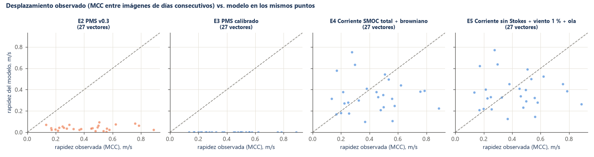

### Llegada a costa (evaluación)

| Experimento | Horizonte | Aciertos / fallos / falsas alarmas / negativos | POD | FAR | CSI |
|---|---|---|---|---|---|
| E0 Persistencia | +3 d | 20 / 6 / 6 / 38 | 0.77 | 0.23 | 0.62 |
| E0 Persistencia | +5 d | 20 / 16 / 6 / 40 | 0.56 | 0.23 | 0.48 |
| E0 Persistencia | +7 d | 18 / 10 / 8 / 35 | 0.64 | 0.31 | 0.50 |
| E1 Solo browniano | +3 d | 20 / 6 / 4 / 40 | 0.77 | 0.17 | 0.67 |
| E1 Solo browniano | +5 d | 20 / 16 / 5 / 41 | 0.56 | 0.20 | 0.49 |
| E1 Solo browniano | +7 d | 15 / 13 / 8 / 35 | 0.54 | 0.35 | 0.42 |
| E2 PMS v0.3 | +3 d | 19 / 7 / 10 / 34 | 0.73 | 0.34 | 0.53 |
| E2 PMS v0.3 | +5 d | 23 / 13 / 19 / 27 | 0.64 | 0.45 | 0.42 |
| E2 PMS v0.3 | +7 d | 20 / 8 / 19 / 24 | 0.71 | 0.49 | 0.43 |
| E3 PMS calibrado | +3 d | 20 / 6 / 6 / 38 | 0.77 | 0.23 | 0.62 |
| E3 PMS calibrado | +5 d | 20 / 16 / 6 / 40 | 0.56 | 0.23 | 0.48 |
| E3 PMS calibrado | +7 d | 17 / 11 / 8 / 35 | 0.61 | 0.32 | 0.47 |
| E4 Corriente SMOC total + browniano | +3 d | 22 / 4 / 9 / 35 | 0.85 | 0.29 | 0.63 |
| E4 Corriente SMOC total + browniano | +5 d | 24 / 12 / 20 / 26 | 0.67 | 0.45 | 0.43 |
| E4 Corriente SMOC total + browniano | +7 d | 23 / 5 / 19 / 24 | 0.82 | 0.45 | 0.49 |
| E5 Corriente sin Stokes + viento 1 % + ola | +3 d | 20 / 6 / 16 / 28 | 0.77 | 0.44 | 0.48 |
| E5 Corriente sin Stokes + viento 1 % + ola | +5 d | 25 / 11 / 24 / 22 | 0.69 | 0.49 | 0.42 |
| E5 Corriente sin Stokes + viento 1 % + ola | +7 d | 23 / 5 / 22 / 21 | 0.82 | 0.49 | 0.46 |
| E5 Corriente sin Stokes + viento 2 % + ola | +3 d | 20 / 6 / 15 / 29 | 0.77 | 0.43 | 0.49 |
| E5 Corriente sin Stokes + viento 2 % + ola | +5 d | 27 / 9 / 27 / 19 | 0.75 | 0.50 | 0.43 |
| E5 Corriente sin Stokes + viento 2 % + ola | +7 d | 22 / 6 / 28 / 15 | 0.79 | 0.56 | 0.39 |
| E5 Corriente sin Stokes + viento 3 % + ola | +3 d | 21 / 5 / 21 / 23 | 0.81 | 0.50 | 0.45 |
| E5 Corriente sin Stokes + viento 3 % + ola | +5 d | 28 / 8 / 30 / 16 | 0.78 | 0.52 | 0.42 |
| E5 Corriente sin Stokes + viento 3 % + ola | +7 d | 23 / 5 / 28 / 15 | 0.82 | 0.55 | 0.41 |

POD: fracción de tramos con sargazo costero observado que el modelo anticipó; FAR: fracción de avisos sin sargazo observado; CSI: aciertos / (aciertos + fallos + falsas alarmas).

### Caso de la fecha de nuestro dirmarea.txt (01/10/2026)

**¿Coincide el `dirmarea.txt` de SEMAR con el oleaje real de ese día?** Comparado con la ola de viento de MFWAM en 1295 nodos del recuadro a las 00 UTC: altura media SEMAR 1.02 m vs. real 0.81 m (sesgo +0.21 m, RMSE 0.38 m, correlación 0.47); dirección media SEMAR 97° vs. real 97° (diferencia mediana por nodo 9°, p90 28°). Como los 41 bloques de SEMAR son idénticos, la diferencia en los días siguientes es:

| Hora | Altura SEMAR / real (m) | RMSE altura (m) | Correlación | Dirección SEMAR / real | Dif. dirección mediana |
|---|---|---|---|---|---|
| +0 h | 1.02 / 0.81 | 0.38 | 0.47 | 97° / 97° | 9° |
| +24 h | 1.02 / 0.89 | 0.36 | 0.58 | 97° / 107° | 15° |
| +48 h | 1.02 / 0.69 | 0.49 | 0.58 | 97° / 102° | 18° |
| +72 h | 1.02 / 0.49 | 0.61 | 0.59 | 97° / 111° | 13° |
| +96 h | 1.02 / 0.44 | 0.66 | 0.40 | 97° / 100° | 8° |
| +120 h | 1.02 / 0.25 | 0.86 | 0.14 | 97° / 102° | 12° |

**¿Y la simulación con lo que vio el satélite después?** El 01/10/2026 el satélite vio 1374 píxeles con sargazo con 6 % del mar despejado; **no cumple los criterios de caso** (Menos de 50% del mar despejado en t0), así que este resultado es ilustrativo y no entra en las tablas.

| Experimento | FSS 25 km +3 d | FSS 25 km +5 d | FSS 25 km +7 d |
|---|---|---|---|
| E0 Persistencia | 0.059 | 0.185 | 0.048 |
| E2 con el dirmarea.txt de SEMAR | 0.037 | 0.150 | 0.020 |
| E2 PMS v0.3 | 0.062 | 0.146 | 0.023 |
| E4 Corriente SMOC total + browniano | 0.033 | 0.033 | 0.064 |

### Casos uno por uno

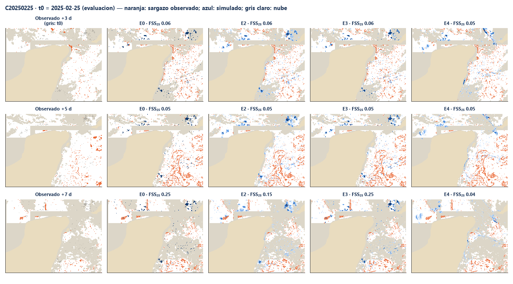

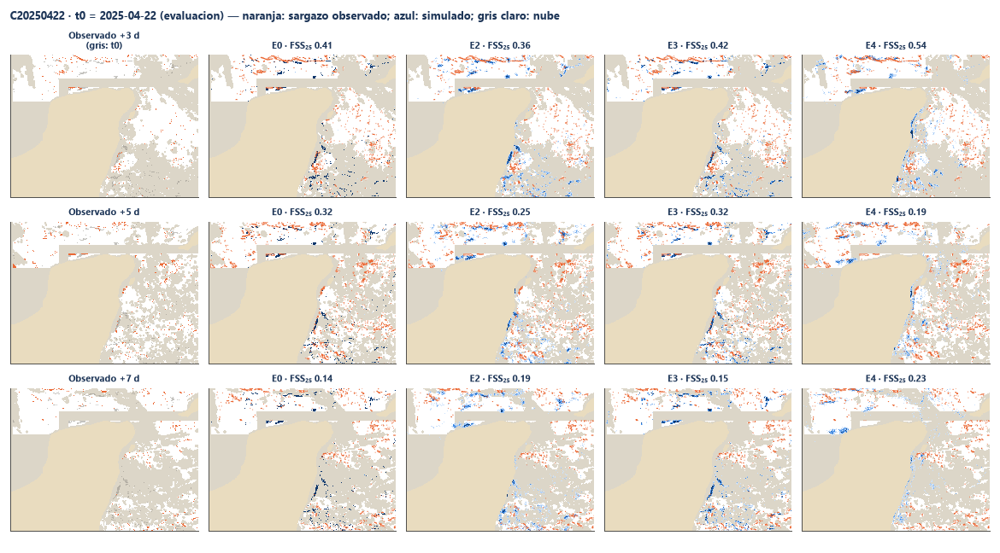

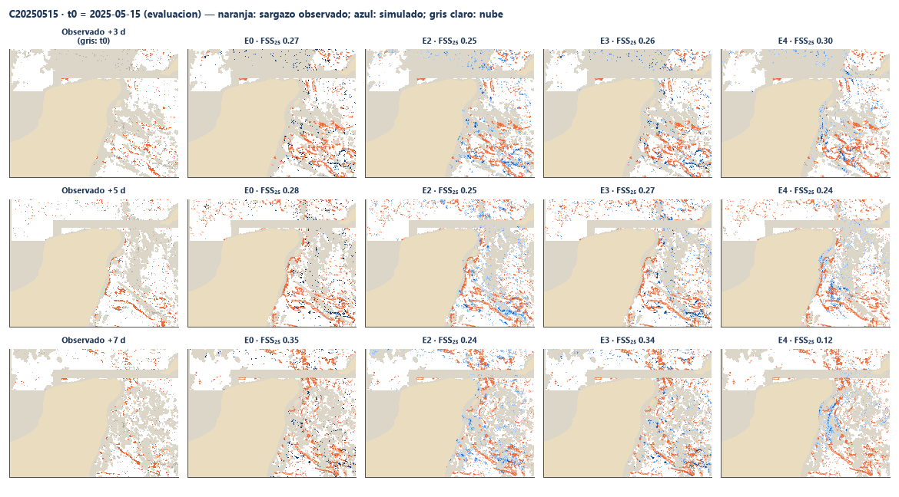

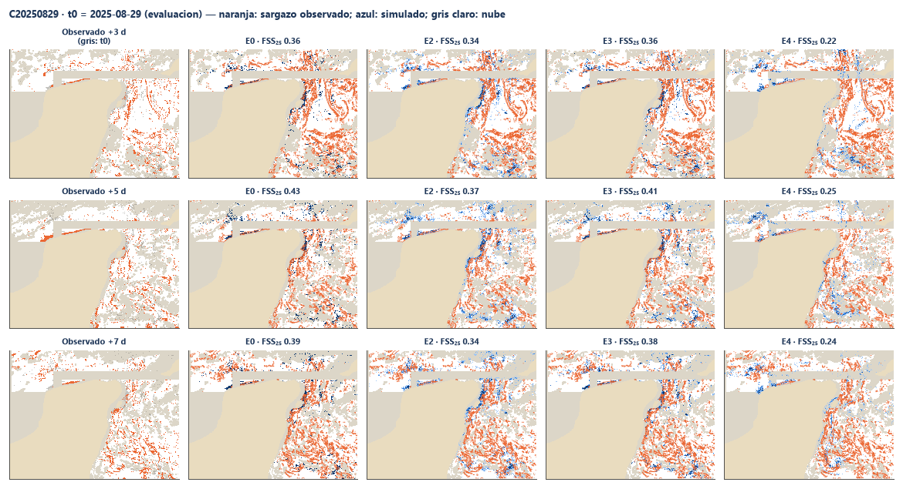

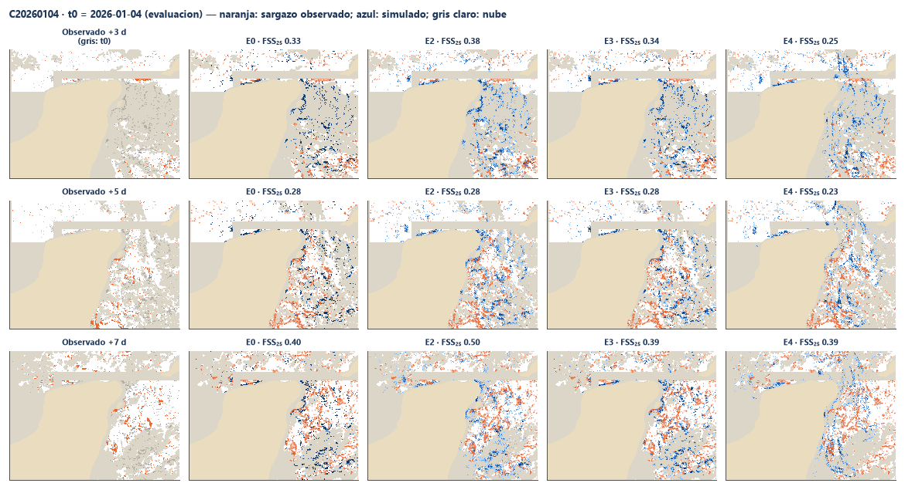

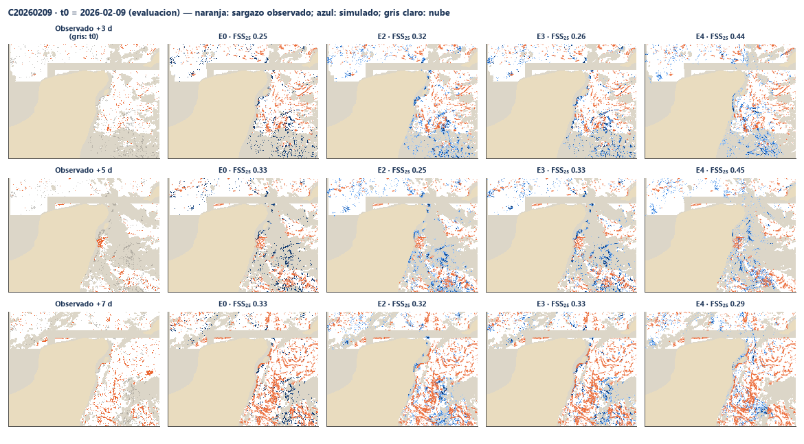

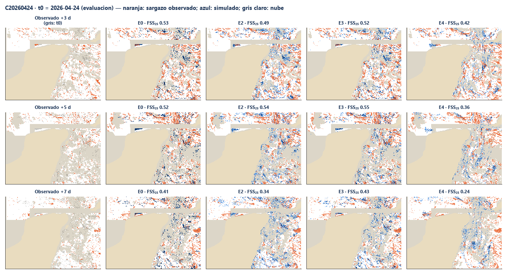

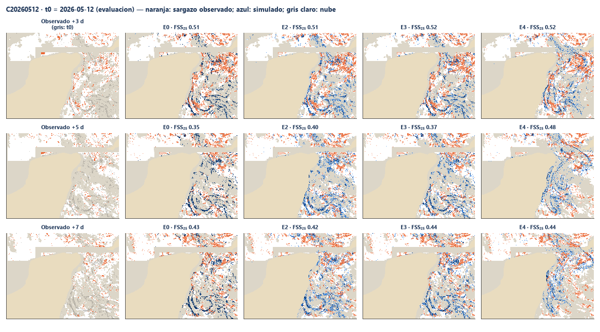

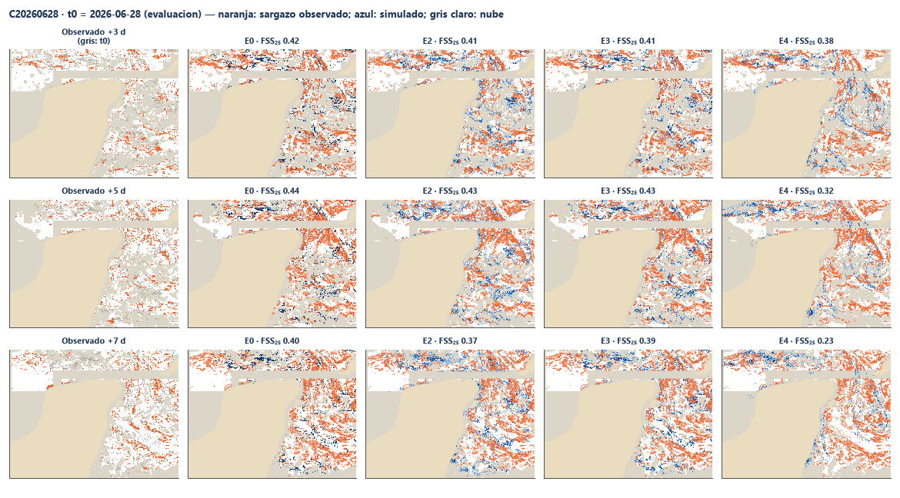

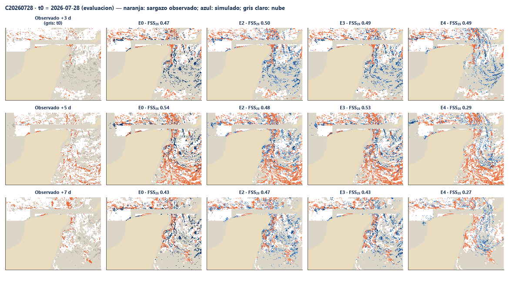

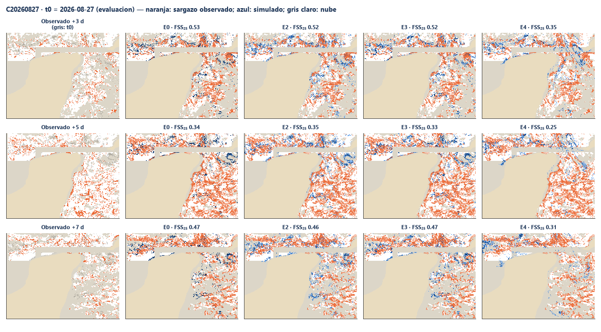

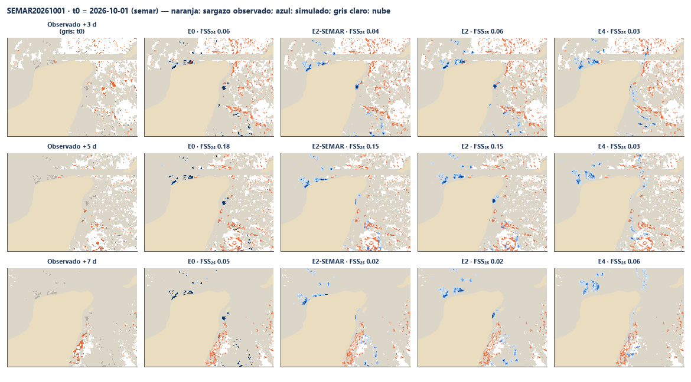

## Qué significa y qué no

- **Sí** mide si el modelo pone el sargazo donde el satélite lo vio días después mejor que no moverlo, con casos que no se usaron para calibrar.
- **No** es una validación de llegada a playa con datos de campo: el satélite no ve el sargazo ya varado y los píxeles pegados a la costa suelen salir con nube, mezcla de tierra o fondo somero.
- **No** valida el oleaje de SEMAR operativo: se usó oleaje de MFWAM en el formato de SEMAR; con el archivo de SEMAR solo hay una fecha y sus 41 bloques son idénticos.
- Un FSS bajo en todos los experimentos (incluida la persistencia) también refleja lo difícil de la observación: el sargazo aparece y desaparece entre imágenes por nubes, por el umbral y porque se hunde o se agrega.

## Limitaciones

- **Nubes**: la mayoría de los días no sirven; los casos elegidos son los días más despejados, que pueden no representar las condiciones de tormenta.
- **Umbral AFAI**: T0 = 1.79×10⁻⁴ viene de MODIS en el Atlántico central; el producto de AOML puede mezclar sensores y en aguas someras hay falsos positivos (mitigados con la máscara de brillantes persistentes). Sin máscara de sombra de nube.
- **Resolución**: píxel de ~1.6 km (el sargazo forma filamentos de decenas de metros); malla del modelo de 0.16°; ola de Copernicus Marine a 0.083° (0.2° en el reanálisis antes de nov 2022) interpolada a 0.16° para el `dirmarea.txt`; corriente a 0.083°; viento de Open-Meteo a 0.48° interpolado.
- **Ola sin período real en el producto**: el producto supone T = 4·√H; aquí se comparó con el período de MFWAM (ver arriba), pero el modelo sigue usando el supuesto.
- **Sin corrientes en el producto**: E4 y E5 son experimentos de este módulo, no del producto. La corriente de SMOC ya incluye la deriva por oleaje y la marea.
- **Forzamientos de análisis y pronóstico**: MFWAM y SMOC de análisis/pronóstico son la mejor estimación operativa de cada día, no un reanálisis; antes de nov 2022 la ola sale del reanálisis a 0.2°, más grueso.
- **Pocos casos**: 11 de evaluación; los intervalos de confianza lo reflejan.

## Cómo reproducir

```powershell
python -m pip install -r requirements-validacion.txt
copernicusmarine login            # solo la primera vez
python scripts/validar.py          # descarga a data/validacion/ (no se sube a git) y escribe docs/validacion/
```

Copernicus Marine pide cuenta gratuita: la primera vez se corre `copernicusmarine login` en la terminal y las credenciales quedan en la carpeta del usuario, nunca en el repositorio. El viento de Open-Meteo usa ~170 llamadas por caso de su cuota gratuita diaria; todo lo descargado queda en la caché y el script continúa donde se quedó.
